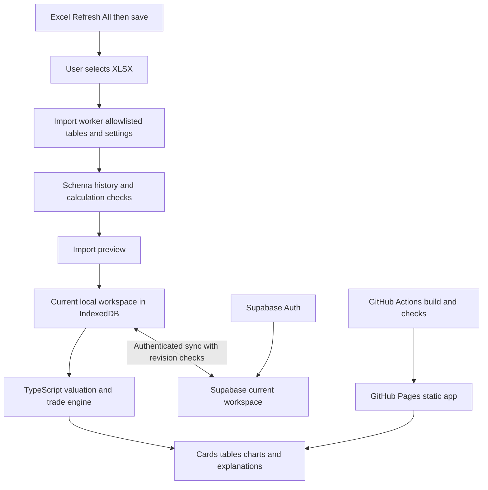

# Fantasy Football GUI Architecture

Specification version 1.0 · October 14, 2026 · Status: proposed for implementation

Build a personal fantasy football web app hosted on GitHub Pages, with Supabase authentication and synchronization. Import the refreshed Excel workbook locally, extract only the required data, and replace the account’s current dataset. Open to Los Chilones and reproduce every functional workbook feature through cards, sortable tables, and expandable calculation details.

This specification defines the application architecture and release checks. It does not deploy infrastructure or change the workbook’s valuation assumptions.

## 1. Decisions and boundaries

| Area | Decision |
| --- | --- |
| Hosting | GitHub Pages serves the compiled application. Supabase provides authentication and current-state storage. |
| Data update | User refreshes and saves Excel, then imports the workbook in the browser. |
| File retention | Do not upload or persist the original XLSX. Keep one current extracted dataset per account, replacing it on import. |
| Devices | Synchronize the current dataset, settings, team selection, and one current trade draft across signed-in devices. |
| Landing screen | Los Chilones overview; resolve the team by imported ID and name. Allow changing the preferred team. |
| Scope | Include all workbook functions in the first complete release. Implement them in stages, with feature parity required before release. |
| Presentation | Cards and sortable tables with optional calculation explanations and charts. |
| Calculation authority | A versioned TypeScript domain engine reproduces the supported workbook model. Imported Excel results are comparison evidence, not executable formulas. |

Excel remains the ESPN refresh mechanism. The app has no direct ESPN integration, performs no league transactions, and does not automate Excel from a hosted browser. Workbook import is a data update, not an ESPN refresh.

GitHub Pages serves static HTML, CSS, and JavaScript; the interactive calculations run in the browser and private data resides in Supabase. This division fits GitHub’s documented hosting model. [GitHub Pages](https://docs.github.com/en/pages/getting-started-with-github-pages/what-is-github-pages)

## 2. System layout



The import worker reads file bytes only in memory. No workbook is sent to GitHub, Supabase Storage, a parsing service, or telemetry. Supabase receives the validated extracted data after the user reviews the import. The current local workspace is available offline after it has been loaded on that device.

## 3. Application components

| Component | Responsibility | Proposed technology |
| --- | --- | --- |
| Web interface | Routes, forms, cards, tables, comparisons and accessible charts | React and TypeScript |
| Build and hosting | Compile static assets, set repository base path, publish tested builds | Vite and GitHub Actions |
| Workbook adapter | Read XLSX tables, names, cached values and supported settings | SheetJS CE in a Web Worker |
| Contract validation | Validate imported and downloaded payloads at runtime | Zod schemas |
| Domain engine | Pure calculations for values, baselines, grades, lineups and trade scenarios | TypeScript modules in a calculation worker |
| Local persistence | One account-scoped current workspace and current unsynced intent | IndexedDB through a small typed repository layer |
| Cloud persistence | Authentication, current workspace and controlled atomic updates | Supabase Auth and Postgres RPC |
| Verification | Unit, parity, browser and authorization tests | Vitest, Playwright and SQL tests |

Use a dependency lockfile and pin reviewed package releases during implementation. These technology selections are proposed, not evidence that packages are already installed. Do not copy Trainwise’s entire application or its workout data model. Follow its local-first interaction and sign-in pattern while implementing a dedicated fantasy schema.

Use hash routes, such as `/#/trades`, so GitHub Pages deep links do not depend on server-side route rewriting. Set Vite’s base path to the final repository path and scope the service worker accordingly. [Vite deployment guidance](https://vite.dev/guide/static-deploy.html#github-pages)

## 4. Screen and feature inventory

| Screen | Required functionality |
| --- | --- |
| My Team | Los Chilones by default; roster, starter strengths, position grades, coverage, useful reserves, injury and data warnings, gems and buy-low/sell-high signals. |
| Teams | Team dropdown, full roster, every current evaluation statistic, position advice, league-median comparisons and depth. |
| Players | Search, ownership/position/injury filters, rankings, selectable sorting, player comparisons, ESPN weekly and season projections, ADP comparisons. |
| Player detail | Actual and recent scores, season projected PPG, Expected PPG, consistency adjustment, Value PPG, replacement candidates, VORP, surplus index, workload, regression signals and source status. |
| Trades | Up to five players per side, searchable selectors, optional IDs, both teams’ lineups, deal grade/bar, package requirements, legality, drops, waiver proposals, depth and injury scenarios. |
| Gems | Current Gem_Screener filters, sortable shortlist, evidence explanations, trends, workload support, projection gaps and value versus replacement. |
| Weekly | Separate K and D/ST view with opponent, bye, actual scoring and current-week ESPN projection. |
| Model and Audit | Adjustable settings, baseline audit, calculation explanations, history/duplicate issues, import checks and read-only views of supported source tables. |
| Data and Account | Import/replace, snapshot and import timestamps, sync/conflict status, login/logout, local data removal and deletion of the cloud workspace. |

The dashboard and team roster retain compact gem and trend signals. Player comparisons must distinguish recorded averages, ESPN projections and model forecasts. Current-week ESPN points never substitute for season projected PPG.

Existing raw sheets become read-only data/audit views where they support a workbook function. Excel-specific formatting, table bindings, credentials and Power Query editing remain in Excel. The initial implementation must inventory every existing named calculation, setting and output and map it to an app module or screen; unmapped functions block feature-parity sign-off.

## 5. Workbook import contract

### Supported profile

Start with a structural adapter for the V5.2 workbook. Identify it by required table names, column signatures and supported setting names, not by the filename. Fail clearly on unsupported layouts. Do not assume that a renamed V5.1 workbook supports V5.2 features.

| Excel table | Canonical collection | Required information |
| --- | --- | --- |
| ModelContext | context | Season, current/final scoring periods, refresh UTC, scoring rules, starter slots, bench/IR capacities and position limits |
| ModelTeams | teams | TeamID and TeamName |
| ModelPlayers | players | Stable ID, position, NFL team, ownership, injury, eligibility, droppable flag, actual aggregates, projections, workload, ADP and source timestamp |
| ModelHistory | history | PlayerID, season, week, league-scored points, participation, record count, history status and timestamp |
| ModelSchedule | schedule | NFL team ID, week, has-game flag, bye, opponent and source game status |
| ModelRosters | rosters | TeamID, PlayerID and ESPN lineup slot ID |

Also read an explicit allowlist of model, premium, grading and gem settings and supported current selections. Named references are resolved only within supported local cells/ranges; arbitrary formulas are never evaluated. If a supported setting lacks a name, the versioned adapter may use a documented label and address mapping.

Do not extract connection strings, Power Query M, custom XML, external links, embedded objects, credentials or arbitrary workbook notes. Treat all cell text as data: render escaped text and never execute workbook instructions, hyperlinks, HTML or formulas.

### Import sequence

1. User refreshes Excel, waits for completion, recalculates and saves.
2. Read and validate the XLSX package inside an isolated worker. Apply proposed limits of 25 MiB compressed, 150 MiB expanded and 10 MiB canonical JSON; tune only after measuring the real workbook. Check package size before parsing and bound row counts and worker runtime.
3. Locate required tables and settings, normalize typed values, and validate referential integrity. IDs use canonical strings; `OnTeamID = 0` means available/waivers. Missing ownership is an error, not free agency.
4. Check history uniqueness by player/season/week, participation, aggregate reconciliation, projection provenance and schedule coverage. Exact equivalent duplicates may be coalesced with a warning; conflicting duplicates invalidate affected metrics.
5. Calculate app results from the imported snapshot and settings. Compare them with supported cached Excel outputs when present. Source integrity checks remain mandatory even if output caches are absent.
6. Show counts, source age, imported settings, supported features and blocking/conditional issues. Preserve existing app settings by default on later imports; show the workbook settings as a separate selectable set. Run parity comparison with workbook settings even when the user keeps app overrides.
7. On import confirmation, replace the local current dataset in one IndexedDB transaction, mark it pending sync, and send the cloud replacement with the expected revision. Keep the previous usable state until local validation/commit succeeds. A failed cloud write does not erase the new local import or silently replace the cloud dataset.
8. Release file bytes and discard canceled preview data. Revalidate the current trade draft by PlayerID and ownership against the new snapshot.

SheetJS reads workbook data and formula representations but does not automatically calculate formulas. The app therefore implements the domain model explicitly. Missing formula caches must not become zeros; unsupported required source calculations prompt the user to save a recalculated workbook. [SheetJS formula documentation](https://docs.sheetjs.com/docs/csf/features/formulae/)

Store source refresh UTC separately from import UTC and sync UTC. Importing or synchronizing old data does not make it fresh. Preserve the current workbook’s greater-than-24-hour stale warning, calculated from UTC timestamps, and display times in the user’s local timezone. Missing or implausible timestamps produce an explicit status.

## 6. Canonical data and calculation contracts

The dataset contains `schemaVersion`, `adapterVersion`, `modelVersion`, source timestamps, context, teams, players, history, schedule, rosters and imported settings. It also contains a sanitized import report and content hash. Retain only allowlisted calculation references needed for parity and explanations, not an entire copy of Excel’s cell grid.

Represent unavailable numbers as `null` with a status and reason. A genuine zero stays numeric zero. Every displayed metric has a defined unit, provenance category and availability state. Use states `usable`, `conditional`, `unavailable` and `invalid`; expose specific reasons instead of only a colored icon.

Expose a single versioned API:

```ts
evaluatePlayers(dataset, settings): PlayerEvaluation[]
buildReplacementAudit(dataset, evaluations): ReplacementAudit[]
evaluateTeam(dataset, evaluations, teamId): TeamEvaluation
evaluateTrade(dataset, evaluations, tradeDraft, settings): TradeEvaluation
screenGems(dataset, evaluations, settings): GemEvaluation[]
```

Results carry the dataset hash, model version, settings hash and relevant status reasons. Cache keys include all three; never reuse a trade result after ownership, settings or source data changes. Recompute derived results on each device rather than synchronizing a competing set of authoritative calculations.

For actual-history metrics, verify the workbook’s Power Query-prepared aggregates against completed played games. Preserve verified zero/negative scores and injury-shortened games; exclude byes and nonparticipation. If those sources conflict, mark the affected calculations invalid instead of selecting the more favorable number.

## 7. Valuation engine

Preserve the existing adaptive model and imported user settings. Defaults below describe the model, not hardcoded settings to overwrite on import.

```text
Actual PPG       = completed played-game points / games played
Recent PPG       = mean of latest 3 played games, or all games if fewer
Observed PPG     = 0.75 × Actual PPG + 0.25 × Recent PPG
Actual weight    = games played / (games played + 4)
Expected PPG     = weight × Observed PPG + (1 − weight) × ESPN season projected PPG
Consistency loss = min(0.10 × Expected PPG, 0.10 × sample SD × weight)
Value PPG        = Expected PPG − consistency loss
```

Apply consistency loss only after four played games and only when Expected PPG is positive. With no history and a usable projection, use projection-only status. With no usable projection and at least four verified games, use observed-only status. Other insufficient data remains unavailable. Preserve the supported workbook’s projection-record validation and season AppliedAverage/fallback meaning.

For each position, baseline = mean Value PPG of the top three eligible available players, sorted by Value PPG descending and PlayerID ascending. Eligibility requires confirmed free-agent/waiver ownership, active injury status, usable complete model data, no unresolved long-term availability, and at least one remaining scheduled game through the imported final fantasy week, currently Week 17. A current bye does not disqualify a season replacement. One/two candidates make the baseline conditional; none makes it unavailable.

```text
VORP             = (Value PPG − positional baseline) × available remaining games
Positive VORP    = max(0, VORP)
Surplus index    = 100 × Positive VORP / maximum positive VORP
```

Keep negative VORP visible. If usable valuations exist but none has positive VORP, their indices are zero. Missing valuations remain unavailable. Baselines use the real imported ownership snapshot and are frozen across hypothetical trade scenarios. Only a new import or model-setting change rebuilds them.

Index explanation: “Relative remaining-season surplus above available replacements; not a market price.” Reproduce offensive ranks and draft ADP comparisons using the workbook’s ranking/tie rules. Label market edge as draft ADP minus model offensive rank, never as a current trade-market quote.

## 8. Lineups and trade scenarios

### Legal lineups

For each remaining fantasy week, build legal lineups using imported starter counts, eligible slots, IR rules, roster capacities, positional limits, byes and availability. Select by Value PPG and calculate Expected PPG for those same selected players. Tie-breaking follows the supported workbook; IDs must be deterministic. Fill a legal slot when an eligible player is available; unfilled slots contribute zero and are explicitly reported.

Implement slot assignment as a deterministic constrained assignment problem. Validate assignments against the workbook’s existing single-position/FLEX behavior; any newly supported roster format requires its own parity fixture. Confirmed current absences are excluded. Unknown return dates follow explicit available/unavailable scenarios and make results conditional; do not invent missed-game counts.

Keep these stages separate for both teams:

1. Existing roster and weekly lineups.
2. Trade with required drops and legal roster repair.
3. Optional waiver fills shown as separate proposals and incremental gains.

Required drops minimize the loss of remaining-season lineup value among legal, droppable candidates that reduce the conflict. Recompute after each drop; the existing workbook breaks equal losses by lower surplus index, then PlayerID. Waiver fills maximize incremental lineup value, recomputing after each choice; the existing tie-break is higher surplus index, then PlayerID. Preserve that rule explicitly rather than substituting Value PPG, which can produce a different order across positions. Preserve the workbook’s deterministic proposal order and prevent both teams from acquiring the same player. Explain that proposals are conditional on successful claims.

### Results that must remain separate

| Result | Calculation or meaning |
| --- | --- |
| Surplus deal grade | Incoming versus outgoing summed Positive VORP, from the selected team’s perspective; premium excluded |
| Surplus package requirement | Equal counts compare incoming/outgoing directly; unequal counts require the larger package to reach the smaller package × (1 + premium) |
| Fantasy-points requirement | Consistency-adjusted remaining-season points; unequal packages also apply the premium once and add required-drop replacement cost |
| Expected scoring gain | After-minus-before Expected PPG totals for the same Value PPG-selected lineups |
| Adjusted lineup value gain | After-minus-before Value PPG totals for those lineups |
| Legality and depth | Ownership, duplicates, capacities, IR, position limits, undroppable rules, coverage and useful backups |
| Uncertainty | Injuries, missing/conditional baselines, source issues and stale data |

Drop cost = sum of `max(0, baseline PPG) × dropped player’s available remaining games`, using the applicable receiving team’s required drops. Include it exclusively in the fantasy-points requirement. Never add it to surplus units or to lineup gains a second time. Thin pools make affected conclusions conditional; unavailable baselines prevent definitive affected surplus verdicts.

Report scoring gains both as total points through the final fantasy week and per remaining fantasy week. The weekly denominator is the number of scoring periods in the horizon, including weeks with incomplete lineups. Label an average as “average modeled gain per remaining week”; it is not a guarantee of that gain every week or an ESPN weekly projection. Provide the weekly series alongside the average. Do not introduce new gain classifications until separately agreed.

### Deal grades and bar

Let `a = (incoming surplus − outgoing surplus) / outgoing surplus`. Preserve imported grade thresholds; current defaults are:

| Advantage | Grade |
| --- | --- |
| a ≤ −50% | Horrible deal |
| −50% < a ≤ −20% | Bad deal |
| −20% < a < −5% | Less than ideal |
| −5% ≤ a ≤ +5% | Fair deal |
| +5% < a < +20% | Good deal |
| +20% ≤ a < +50% | Excellent deal |
| a ≥ +50% | Steal deal |

Both zero surplus: “Not distinguishable above replacement.” Zero outgoing and positive incoming: explicit positive-surplus wording, with percentage unavailable. Show absolute surplus difference and shortfalls to even exchange, the fair band and package requirements.

Center the advantage bar at zero; cap its visual extent at ±100%, retaining the uncapped numeric value. Positive advantage uses green, modest negative advantage above the bad-loss threshold uses orange, larger losses use red, and exactly even/unavailable uses neutral gray. These deal-grade/bar colors are the explicit exception to the metric font-color scheme. A favorable grade does not override legality, lineup loss or uncertainty.

## 9. Position grades and gem signals

Position grades compare average modeled starter Value PPG per configured slot through the horizon against the median of usable teams at that position in the imported fantasy league. The current league has nine teams. Unfilled starter slots count as zero. Allocate FLEX before classifying reserves. Depth and injury conditions remain separate from the letter grade.

Preserve the current grade lower bounds: F below −35%; D− at −35%; D at −30%; D+ at −25%; C− at −20%; C at −15%; C+ at −10%; B− at −5%; B at 0%; B+ at +5%; A− at +10%; A at +15%; A+ at +25%. Missing player values or an unusable median prevent a definitive grade. Preserve the existing useful-reserve and limited-spare-value rules and their editable thresholds.

Legacy Gem signals below reproduce V5.2 only in `workbookMode` parity verification:

- Supported candidate: at least four games, actual PPG ≥ projection +2 and ≥20% above a positive projection, recent PPG ≥ projection, plus workload support.
- WR support: ≥6 targets/game and ≥18% team target share. TE: ≥5 and ≥10%. RB: ≥12 carries plus targets/game and either ≥30% rushing share or ≥10% target share.
- Opportunity watch: workload support plus existing BUY LOW. Projection-gap watch: scoring support without sufficient modeled workload support. Emerging: promising evidence with fewer games. Existing SELL HIGH takes TD-caution precedence once the sample threshold is met.
- Trend compares the latest three played games with all earlier played games, requiring at least two earlier games. Up/down requires both 1 PPG and 10% of the absolute earlier mean; exactly zero change is stable. Zero earlier mean makes percentage change unavailable. Preserve V5.2’s ten-decimal stabilization of the earlier mean.
- Display small-sample warnings, missing-data states, injury status and value versus replacement. Workload shares describe the imported player pool’s NFL-team totals and are conditional if that coverage is incomplete.

The app uses `breakout-1` in `src/domain/gems.ts`, independently of valuation. A Gem requires at least five verified played games, last-three workload mean/floor/growth gates, active availability and current sourced support for an ongoing role. Compare workload with the immediately preceding three games (two allowed at five total). RB gates are 18 carries+targets mean, 14 EACH-game floor and +3 growth; WR uses 7 targets mean, 5 floor and +2; TE uses 6, 5 and +2. Growth must also reach 25%, except that a zero prior workload requires only absolute growth and leaves the percentage unavailable. Existing scoring Trend PPG still compares last three against ALL earlier games.

Watch means developing-role evidence is promising but a gate remains unresolved or inconsistent. No breakout signal includes unchanged established production. Missing/invalid played workload means insufficient data. QB/K/DST have no new breakout classifier. Independent projection-gap, role-growth, scoring-breakout and TD signals remain supporting information, never automatic Gem qualification or valuation bonuses.

`gemBreakoutRules` and `gemRoleReviews` use bounded, versioned JSON in the existing private synced filters. No database/workbook schema change is needed. Role reviews have PlayerID, current Week, ThroughWeek (latest completed game reviewed), Outlook, Source, AsOfUTC and Reason. Ongoing, temporary and unclear outlooks are explicit assertions, not automatically verified news. Current support requires snapshot matching, coverage of the latest played game, a source at most seven days old and a snapshot at most 24 hours old. New imports invalidate old reviews. Injured same-team competition produces review prompts without inferring causation. Optional role-review CSV imports replace only this review set. Shared gate tables explain classification in the popover and full profile. Configuration remains provisional and adjustable; no breakout probability is claimed.

Screener version 2 adds All classifications, Gem only and Gem + Watch. Independent signals retain OR matching; all categories and numeric thresholds use AND. Empty signal selections still allow numeric-only screening. Legacy labels migrate with a visible review requirement and preserve numeric thresholds. Cache and React recalculation identity include both classifier inputs. Valuation, trade math and the dataset model version stay unchanged.

Carry forward buy-low/sell-high regression calculations, opportunity thresholds and xTD explanations from the workbook. They are supporting evidence, not added index bonuses. All pool, weight, grade, workload and premium assumptions remain provisional without historical validation.

## 10. Supabase current-state schema

Use one application row per account. Do not use Trainwise’s append-only snapshot table for fantasy data. Reusing an existing Supabase project is possible, but keep fantasy table/function names separate and make no changes to Trainwise data or policies.

```text
fantasy_workspaces
  user_id                 uuid primary key references auth.users(id) on delete cascade
  dataset                 jsonb nullable
  dataset_schema_version  integer
  adapter_version         text
  model_version           text
  dataset_hash            text
  dataset_revision        bigint not null default 0
  source_refresh_utc      timestamptz nullable
  imported_at             timestamptz nullable
  state                   jsonb not null default '{}'
  state_revision          bigint not null default 0
  last_dataset_request_id uuid nullable
  last_state_request_id   uuid nullable
  updated_at              timestamptz not null
```

`state` holds current settings/overrides, preferred team, filters and one trade draft. It holds no imported-file history. SQL constraints and RPC validation enforce supported schemas, bounded payload size, finite numbers, revision rules and required references. Schema validation in the browser is also required when downloading data; a cloud row is not implicitly trusted.

Provide four authenticated RPCs:

| Function | Contract |
| --- | --- |
| replace_fantasy_dataset | Expected dataset revision, request ID and validated dataset; atomically replace the current dataset, increment revision, reconcile draft IDs and return committed revision/hash. |
| update_fantasy_state | Expected state revision and expected dataset revision for dataset-dependent selections; update current state without resending the dataset. |
| get_fantasy_workspace | Return only the signed-in user’s current row and revision metadata. |
| delete_fantasy_workspace | Delete only the caller’s current workspace and return a deletion result. |

Use authenticated identity from the session, never a caller-supplied owner ID. Compare-and-swap checks occur inside a database transaction with a row lock; handle initial-row creation atomically. Repeated immediately retried request IDs return the existing result. A delayed old request must conflict rather than overwrite a newer commit. Do not create a request-history table.

RLS permits reading only rows where `auth.uid() = user_id`; signed-out users get no data. Revoke direct client write access so all modifications use the revision-checking RPCs. If the RPC implementation uses narrowly scoped SECURITY DEFINER functions to enforce this write-only path, explicitly check `auth.uid()`, qualify relation names, set an empty `search_path`, revoke public/anonymous execution and grant only required authenticated execution. Test these functions separately because definer functions can bypass RLS. [Supabase RLS](https://supabase.com/docs/guides/database/postgres/row-level-security), [database function security](https://supabase.com/docs/guides/database/functions)

The deployed frontend contains only the Supabase URL and publishable key. It contains no secret/service-role key or ESPN cookies. Authentication supplies the user identity; the public key alone does not authorize private data access. [Supabase API keys](https://supabase.com/docs/guides/getting-started/api-keys)

## 11. Synchronization and retention

On sign-in or return to the foreground, check cloud revisions and download newer state. An optional realtime notification may trigger a refetch; polling on focus and a manual Sync button are sufficient for the first release. Do not synchronize every recalculated cell.

Use visible states: Local only, Syncing, Synced, Offline changes pending, Conflict and Sync failed. Offline imports replace the local current dataset and queue only the latest desired replacement. When reconnecting, submit against the last known cloud revision. Never silently merge two league snapshots or use timestamp-based last-writer-wins.

On conflict, show the source timestamps and revision summaries and let the user choose the cloud dataset or the pending local dataset. Keeping local data requires an explicit retry against the newly read revision. Settings/trade conflicts preserve one current local draft until resolved; dataset-dependent drafts must be revalidated.

Storage policy:

- Cloud: one current extracted dataset and current app state per account. No XLSX bucket, import archive or retained historical dataset table.
- Device: one current dataset and the latest pending update; old active data is replaced after a successful local commit. Temporary import preview data is discarded after commit/cancel.
- Offline devices may retain their last synchronized dataset until they reconnect or the user clears it. A cloud replacement cannot erase an unreachable browser cache.
- Database provider backups/WAL retention are separate from application history. Do not promise immediate physical erasure from managed backups; document the selected Supabase plan’s retention at deployment.
- Logging records sanitized error codes and timings, not file bytes, player payloads, passwords, sessions or query credentials.

Partition local storage by authenticated user ID. On logout, clear account data from memory and the device’s persistent account cache by default. Use the auth SDK’s session management; never save plaintext passwords. Service-worker caches contain application assets only, not Supabase responses.

## 12. Presentation and accessibility

| Category | Color and treatment |
| --- | --- |
| Recorded facts/calculations from facts | Dark green #166534 |
| ESPN projections | Blue #1D4ED8 |
| Blends and model values | Dark pink #9D174D |
| Editable controls | Purple #6D28D9, with light yellow background where appropriate |
| Unavailable information | Gray #64748B, explicit reason |
| Instructions/explanations | Charcoal #334155 |
| Warnings and failures | Amber/red fills with text labels |

Trend arrows use up/stable/down wording and numeric PPG deltas, with green/red fills. Model outputs retain pink text. The deal-grade/bar exception is documented next to its legend.

Show PPG to two decimals, percentages consistently, and full precision in calculations. Use accessible keyboard selectors, labeled inputs, screen-reader descriptions for bars, focus management for dialogs and text alternatives to every color signal. Desktop tables offer pinned identifying columns; mobile offers cards and expandable details. Target WCAG 2.2 AA contrast and interactions, verified during implementation.

## 13. Source structure and delivery

```text
src/
  app/                 routes and navigation
  features/            overview teams players trades gems weekly audit account
  domain/              contracts valuation replacements lineups trades grades gems
  import/              V5.2 adapter workbook reader validation
  workers/             import and calculation message protocols
  storage/             indexeddb repositories and migrations
  sync/                revisions rpc client conflicts and session handling
  ui/                  shared controls cards tables charts and metric rendering
tests/
  fixtures/            synthetic or sanitized parity inputs and expected outputs
  domain/              calculation and edge cases
  import/              layout cache corruption and credential exclusion cases
  browser/             workflows responsive views offline and conflicts
supabase/
  migrations/          versioned table functions grants and policies
  tests/               ownership concurrency idempotency and size constraints
docs/
  model-contract.md
  workbook-adapter.md
  deployment.md
.github/workflows/     checks and Pages deployment
```

Publish only compiled app assets. Ignore real workbooks, extracted league datasets, local fixtures containing private data, `.env` files and credential-bearing artifacts. Production parity fixtures must be sanitized before entering source control. Use the exact supported model version for each build and provide app-version information in Settings.

GitHub Actions runs dependency installation from the lockfile, type/lint checks, domain/import tests, browser smoke tests and a production build. Only a successful approved release deploys the static artifact. Supabase migrations run as a separate controlled step; no secret database key is bundled into the web app. GitHub documents the Pages build/artifact/deploy flow. [Pages publishing workflow](https://docs.github.com/en/pages/getting-started-with-github-pages/configuring-a-publishing-source-for-your-github-pages-site)

Updating or rolling back the app shell must not silently rewrite current datasets. Use forward-compatible readers or show an explicit unsupported-schema message. Test auth redirects, repository base paths and service-worker updates on the actual Pages URL.

## 14. Performance and failure behavior

Proposed acceptance targets, to be measured rather than claimed as established performance:

| Operation | Target and test scope |
| --- | --- |
| Workbook import | ≤10 seconds on the current approximately 1,052-player snapshot on the reference desktop, with progress and cancel controls |
| Search/filter | ≤150 ms for up to 2,000 players on the reference desktop |
| Trade preview | ≤2 seconds for a five-player-per-side scenario across the remaining horizon after data loads |
| Heavy calculations | Worker-based; do not freeze navigation or leave stale results displayed as current |
| Dataset expansion | Support at least 2,000 players and 40,000 history rows within configured limits |

Record the reference devices and actual measurements in the release report. Cancel obsolete worker requests when inputs change and ignore responses with an old request/dataset/settings version. Missing data disables only affected definitive outputs and explains the missing input. Parser failure leaves the current usable dataset intact. Network/auth failures leave the local current dataset accessible with the correct sync state.

## 15. Implementation stages and acceptance gates

| Stage | Deliverable | Required gate |
| --- | --- | --- |
| 1 Contract and workbook inventory | Supported table/setting map, model contract and sanitized expected outputs | Every workbook function mapped; actual/projection/history semantics verified |
| 2 Import and local workspace | Worker importer, validation, preview, replace and local cache | No workbook persistence or credential extraction; malformed imports preserve current data |
| 3 Calculation engine | Adaptive values, replacements, ranks, regression, gems, grades and lineup/trade engine | Native-Excel parity and edge-case tests pass before user-facing trade advice |
| 4 Complete interface | All screens in the feature inventory, home overview, tables/cards/details and bars | Every mapped feature available; responsive and keyboard workflows verified |
| 5 Auth and sync | Current-row schema, controlled RPCs, conflicts, offline behavior and account controls | Cross-account isolation, revision concurrency, failed writes and deletion tests pass |
| 6 Release | Pages build/deployment, documentation and full user workflow | Refresh/save/import → sync → second device → trade evaluation works end to end |

Calculation checks must cover every player in a known saved snapshot and relevant trade cases, not just a few headline rankings. Compare numeric outputs at absolute tolerance 1e−8 unless an explicitly documented Excel rounding step requires otherwise. IDs, counts, assignments, status labels, grade boundaries and tie outcomes must match exactly. An unexplained disagreement is a migration defect to resolve before parity sign-off; do not adjust formulas to force a preferred ranking.

Required scenarios include zero/negative scores; missing and conflicting history; valid zero and unavailable projections; no/one/two/three replacement candidates; equal-value ties; no positive VORP; zero-outgoing surplus; all grade boundaries; trades from 1-for-1 to 5-for-5 and both unequal directions; required drops and waiver proposals; position/IR/undroppable restrictions; multi-eligible lineups; byes and injury scenarios; Week 17 cutoff and horizon complete; stale timestamps; settings changes; account switching; concurrent imports; retries; offline replacement; worker cancellation; and app/schema upgrades.

Security acceptance includes anonymous access denied, User A unable to read or mutate User B, spoofed owner IDs ignored/rejected, RPC-only writes enforced, and no secret keys or real workbook data in the deployment artifact.

## 16. Deployment inputs still needed

The architecture does not depend on further product choices. Implementation will need the exact repository name/URL, the Supabase project to use or permission to create a separate one, permitted auth redirect URLs, and the preferred authentication method. Email/password sign-in is a proposed starting point consistent with the inspected Trainwise flow; never import stored Trainwise passwords or sessions.

Inspect the existing Trainwise Supabase project before deciding whether to reuse it. Confirm project quotas, backup retention and any ongoing costs at deployment rather than assuming a particular plan. Branding can use a neutral Fantasy Football working title until selected. No repository, Supabase project or hosting configuration is created by this specification.

## Basis of the design

The functional model and import structure were checked against the delivered V5.2 workbook and its existing valuation, trade interpretation, position-grade and gem specifications. Trainwise’s local repository was inspected for its static PWA structure, IndexedDB behavior and Supabase authentication/sync pattern. Its append-only backup schema is deliberately not adopted for fantasy imports.

The linked GitHub, Vite, SheetJS and Supabase documentation supports the platform constraints and security boundaries above. Formula weights, replacement pools, consolidation premium, grade thresholds and gem screens are the existing provisional model assumptions; this architecture does not claim they have been historically validated.
