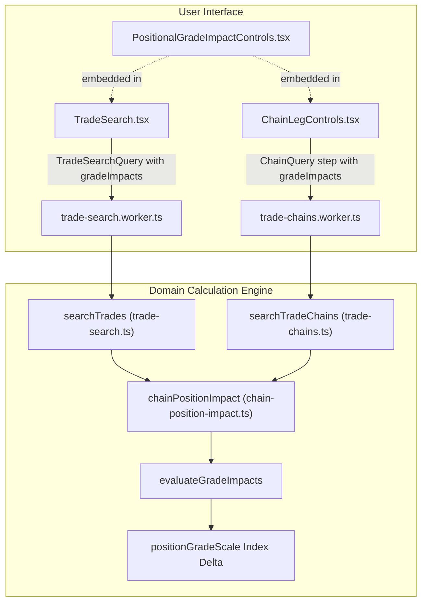

# Positional Grade Impact Search Implementation Plan

> **For agentic workers:** REQUIRED SUB-SKILL: Use superpowers:subagent-driven-development to implement this plan task-by-task. Steps use checkbox (`- [ ]`) syntax for tracking.

**Goal:** Enable fantasy managers to search for trades in "Find Trades" and "Chain Planner" by specific positional grade transitions (e.g. upgrade WR by $\ge +2$ steps while limiting FLEX drop to $\le 2$ steps; or forcing opponent WR downgrade while giving them a FLEX upgrade).

**Architecture:** Extend `chain-position-impact.ts` to compute signed step deltas and evaluate `PositionalGradeImpactRule[]`. Integrate these rules into `TradeSearchQuery` (`trade-search.ts`) and `ChainStep` (`trade-chains.ts`) so search workers evaluate and filter candidates before presenting results. Build a reusable `<PositionalGradeImpactControls>` UI component and embed it into both Find Trades filters and Chain Planner leg controls.

**Architecture Diagram:**


**Tech Stack:** TypeScript, React, Vite, Vitest, Playwright.

**Spec:** [`docs/superpowers/specs/2026-11-06-positional-grade-impact-search-design.md`](file:///c:/Users/israe/OneDrive/Documents/GitHub/fantasy-football-lab/docs/superpowers/specs/2026-11-06-positional-grade-impact-search-design.md)

## Global Constraints
- Keep calculation logic in `src/domain`; UI components must not duplicate formulas.
- Maintain existing `positionGradeScale` order (`F` = 0 to `A+` = 12).
- Zero lint errors (`npm run lint`), strict typecheck (`tsc -b`), full Vitest suite passing (`npm run check`).
- Add helper comments for each block of code produced explaining what it does.

---

### Task 1: Domain Engine - Grade Step Deltas & Rule Evaluation

**Files:**
- Modify: [`src/domain/chain-position-impact.ts`](file:///c:/Users/israe/OneDrive/Documents/GitHub/fantasy-football-lab/src/domain/chain-position-impact.ts)
- Test: [`tests/positional-grade-impact.test.ts`](file:///c:/Users/israe/OneDrive/Documents/GitHub/fantasy-football-lab/tests/positional-grade-impact.test.ts)

**Interfaces:**
- Produces:
  ```ts
  export type GradeImpactSide = "own" | "other";
  export interface PositionalGradeImpactRule {
    id: string;
    side: GradeImpactSide;
    position: string;
    steps: number;
  }
  export interface ChainPositionChange {
    position: string;
    before: string;
    after: string;
    drop: number | null;
    stepDelta: number | null; // Signed: positive = upgrade, negative = downgrade
  }
  export function evaluateGradeImpacts(
    impact: ChainPositionImpact,
    rules?: PositionalGradeImpactRule[],
  ): { passes: boolean; failures: string[] };
  ```

- [ ] **Step 1: Write the failing tests**
Create [`tests/positional-grade-impact.test.ts`](file:///c:/Users/israe/OneDrive/Documents/GitHub/fantasy-football-lab/tests/positional-grade-impact.test.ts) testing:
- Step delta calculation (`C+` to `B` is +2, `B` to `C+` is -2).
- `own` team upgrade rule ($\text{steps} > 0$): passes when $\text{stepDelta} \ge \text{steps}$, fails otherwise.
- `own` team drop budget ($\text{steps} < 0$): passes when $\text{stepDelta} \ge \text{steps}$ (e.g. drop $\le 2$ steps), fails when $\text{stepDelta} < \text{steps}$.
- `other` team upgrade rule ($\text{steps} > 0$): passes when $\text{stepDelta} \ge \text{steps}$.
- `other` team depletion rule ($\text{steps} < 0$): passes when $\text{stepDelta} \le \text{steps}$ (e.g. drops by at least 2 steps).
- Missing/unavailable grade (`"n.a."`) fails rule.

- [ ] **Step 2: Run test to verify it fails**
Run: `npx vitest run tests/positional-grade-impact.test.ts`
Expected: FAIL with missing exports or missing `evaluateGradeImpacts`.

- [ ] **Step 3: Implement domain types & `evaluateGradeImpacts`**
In [`src/domain/chain-position-impact.ts`](file:///c:/Users/israe/OneDrive/Documents/GitHub/fantasy-football-lab/src/domain/chain-position-impact.ts):
- Export `GradeImpactSide` and `PositionalGradeImpactRule`.
- Update `ChainPositionChange` to calculate `stepDelta: first < 0 || last < 0 ? null : last - first`.
- Implement `evaluateGradeImpacts(impact: ChainPositionImpact, rules?: PositionalGradeImpactRule[])`.

- [ ] **Step 4: Run test to verify it passes**
Run: `npx vitest run tests/positional-grade-impact.test.ts`
Expected: PASS with 6 tests passing.

- [ ] **Step 5: Run linter and typecheck**
Run: `npm run check`
Expected: PASS with 0 warnings.

- [ ] **Step 6: Commit**
`git add src/domain/chain-position-impact.ts tests/positional-grade-impact.test.ts`
`git commit -m "feat: add positional grade impact evaluation engine"`

---

### Task 2: Trade Search Integration (`TradeSearchQuery` & `searchTrades`)

**Files:**
- Modify: [`src/domain/trade-search.ts`](file:///c:/Users/israe/OneDrive/Documents/GitHub/fantasy-football-lab/src/domain/trade-search.ts)
- Modify: [`src/workers/trade-search.worker.ts`](file:///c:/Users/israe/OneDrive/Documents/GitHub/fantasy-football-lab/src/workers/trade-search.worker.ts)
- Test: [`tests/trade-search-grade-impact.test.ts`](file:///c:/Users/israe/OneDrive/Documents/GitHub/fantasy-football-lab/tests/trade-search-grade-impact.test.ts)

**Interfaces:**
- Consumes: `PositionalGradeImpactRule`, `chainPositionImpact`, `evaluateGradeImpacts` from `chain-position-impact.ts`.
- Produces:
  - `TradeSearchQuery.gradeImpacts?: PositionalGradeImpactRule[]`
  - `SearchRow.positionImpact?: ChainPositionImpact`

- [ ] **Step 1: Write the failing tests**
Create [`tests/trade-search-grade-impact.test.ts`](file:///c:/Users/israe/OneDrive/Documents/GitHub/fantasy-football-lab/tests/trade-search-grade-impact.test.ts) testing:
- Search with `gradeImpacts` returns only candidate trades whose before/after positional grades satisfy all rules.
- When `gradeImpacts` is absent or empty, search behavior is completely unchanged.
- `SearchRow.positionImpact` is populated on matching search results.

- [ ] **Step 2: Run test to verify it fails**
Run: `npx vitest run tests/trade-search-grade-impact.test.ts`
Expected: FAIL.

- [ ] **Step 3: Implement trade search integration**
- In [`src/domain/trade-search.ts`](file:///c:/Users/israe/OneDrive/Documents/GitHub/fantasy-football-lab/src/domain/trade-search.ts):
  - Add `gradeImpacts?: PositionalGradeImpactRule[]` to `TradeSearchQuery`.
  - Add `positionImpact?: ChainPositionImpact` to `SearchRow`.
  - In `scoreTradeMatch`, if `query.gradeImpacts && query.gradeImpacts.length > 0`:
    - Compute `chainPositionImpact(m, draft, result)`
    - Check `evaluateGradeImpacts(impact, query.gradeImpacts)`
    - If it fails, add nearMiss reason or reject candidate.
    - Attach `positionImpact: impact` to the returned `SearchRow`.

- [ ] **Step 4: Run test to verify it passes**
Run: `npx vitest run tests/trade-search-grade-impact.test.ts`
Expected: PASS.

- [ ] **Step 5: Run full project checks**
Run: `npm run check`
Expected: PASS.

- [ ] **Step 6: Commit**
`git add src/domain/trade-search.ts src/workers/trade-search.worker.ts tests/trade-search-grade-impact.test.ts`
`git commit -m "feat: integrate positional grade impacts into trade search engine"`

---

### Task 3: Chain Planner Integration (`ChainStep` & `searchTradeChains`)

**Files:**
- Modify: [`src/domain/trade-chains.ts`](file:///c:/Users/israe/OneDrive/Documents/GitHub/fantasy-football-lab/src/domain/trade-chains.ts)
- Modify: [`src/workers/trade-chains.worker.ts`](file:///c:/Users/israe/OneDrive/Documents/GitHub/fantasy-football-lab/src/workers/trade-chains.worker.ts)
- Test: [`tests/trade-chains-grade-impact.test.ts`](file:///c:/Users/israe/OneDrive/Documents/GitHub/fantasy-football-lab/tests/trade-chains-grade-impact.test.ts)

**Interfaces:**
- Consumes: `PositionalGradeImpactRule`, `chainPositionImpact`, `evaluateGradeImpacts`.
- Produces:
  - `ChainStep.gradeImpacts?: PositionalGradeImpactRule[]`
  - Per-leg enforcement in `searchTradeChains`.

- [ ] **Step 1: Write the failing tests**
Create [`tests/trade-chains-grade-impact.test.ts`](file:///c:/Users/israe/OneDrive/Documents/GitHub/fantasy-football-lab/tests/trade-chains-grade-impact.test.ts) testing:
- Chain search with `first.gradeImpacts` filters Step 1 candidates to matching grade transitions.
- Chain search with `second.gradeImpacts` filters Step 2 candidates after Stage 1 roster updates.

- [ ] **Step 2: Run test to verify it fails**
Run: `npx vitest run tests/trade-chains-grade-impact.test.ts`
Expected: FAIL.

- [ ] **Step 3: Implement chain search integration**
- In [`src/domain/trade-chains.ts`](file:///c:/Users/israe/OneDrive/Documents/GitHub/fantasy-football-lab/src/domain/trade-chains.ts):
  - Add `gradeImpacts?: PositionalGradeImpactRule[]` to `ChainStep`.
  - In `filterLeg` / plausibility check, evaluate `config.gradeImpacts`:
    - Ensure `leg.positionImpact = leg.positionImpact ?? chainPositionImpact(model, leg.draft, result)`
    - Check `evaluateGradeImpacts(leg.positionImpact, config.gradeImpacts)`
    - Record rejection if failed.

- [ ] **Step 4: Run test to verify it passes**
Run: `npx vitest run tests/trade-chains-grade-impact.test.ts`
Expected: PASS.

- [ ] **Step 5: Run full project checks**
Run: `npm run check`
Expected: PASS.

- [ ] **Step 6: Commit**
`git add src/domain/trade-chains.ts src/workers/trade-chains.worker.ts tests/trade-chains-grade-impact.test.ts`
`git commit -m "feat: integrate positional grade impacts into chain planner"`

---

### Task 4: UI Component `<PositionalGradeImpactControls>`

**Files:**
- Create: [`src/features/PositionalGradeImpactControls.tsx`](file:///c:/Users/israe/OneDrive/Documents/GitHub/fantasy-football-lab/src/features/PositionalGradeImpactControls.tsx)
- Modify: [`src/ui/styles.css`](file:///c:/Users/israe/OneDrive/Documents/GitHub/fantasy-football-lab/src/ui/styles.css)

**Interfaces:**
- Produces:
  ```tsx
  export function PositionalGradeImpactControls({
    rules,
    onChange,
    positions,
    ariaLabelPrefix = "Positional grade goal",
  }: {
    rules: PositionalGradeImpactRule[];
    onChange: (rules: PositionalGradeImpactRule[]) => void;
    positions?: string[];
    ariaLabelPrefix?: string;
  }): JSX.Element;
  ```

- [ ] **Step 1: Implement `<PositionalGradeImpactControls>`**
- Render dynamic list of rule rows with:
  - Team selector: `[Your team / Their team]`
  - Position selector: `[QB, RB, WR, TE, FLEX, K, D/ST]`
  - Impact selector:
    - For `own`: `+1 step (Upgrade ≥ 1)` up to `+5 steps`, `-1 step (Drop at most 1)` down to `-5 steps`
    - For `other`: `+1 step (Upgrade ≥ 1)` up to `+5 steps`, `-1 step (Downgrade by ≥ 1)` down to `-5 steps`
  - Remove button `[✕]`
  - `+ Add Positional Goal` button
- Add accessible styling in [`src/ui/styles.css`](file:///c:/Users/israe/OneDrive/Documents/GitHub/fantasy-football-lab/src/ui/styles.css).

- [ ] **Step 2: Run linter and typecheck**
Run: `npm run check`
Expected: PASS.

- [ ] **Step 3: Commit**
`git add src/features/PositionalGradeImpactControls.tsx src/ui/styles.css`
`git commit -m "feat: add PositionalGradeImpactControls component"`

---

### Task 5: UI Integration in Find Trades & Chain Planner

**Files:**
- Modify: [`src/features/TradeSearch.tsx`](file:///c:/Users/israe/OneDrive/Documents/GitHub/fantasy-football-lab/src/features/TradeSearch.tsx)
- Modify: [`src/features/ChainLegControls.tsx`](file:///c:/Users/israe/OneDrive/Documents/GitHub/fantasy-football-lab/src/features/ChainLegControls.tsx)
- Modify: [`src/features/TradeWorkspace.tsx`](file:///c:/Users/israe/OneDrive/Documents/GitHub/fantasy-football-lab/src/features/TradeWorkspace.tsx)

- [ ] **Step 1: Integrate into TradeSearch.tsx**
- Add `const [gradeImpacts, setGradeImpacts] = useState<PositionalGradeImpactRule[]>([])`.
- Include `gradeImpacts` in `TradeSearchQuery`.
- Embed `<PositionalGradeImpactControls>` in the filter panel with active rule count badge.
- When loading saved searches or reset, preserve/clear `gradeImpacts`.

- [ ] **Step 2: Integrate into ChainLegControls.tsx**
- In `ChainLegControls`: render `<PositionalGradeImpactControls>` for the respective leg (`value.gradeImpacts`).
- Update `onChange` to store `gradeImpacts` on the `ChainStep`.

- [ ] **Step 3: Render Grade Impact Chips on Search Result Cards**
- When `row.positionImpact` is present, display matching positional grade chips directly in the search result cards.

- [ ] **Step 4: Run full project checks**
Run: `npm run check`
Expected: PASS.

- [ ] **Step 5: Run production build**
Run: `npm run build`
Expected: Exit code 0.

- [ ] **Step 6: Commit**
`git add src/features/TradeSearch.tsx src/features/ChainLegControls.tsx src/features/TradeWorkspace.tsx`
`git commit -m "feat: integrate positional grade controls into Find Trades and Chain Planner"`

---

### Task 6: Browser End-to-End Testing & Verification

**Files:**
- Create: [`tests/browser/positional-grade-search.spec.ts`](file:///c:/Users/israe/OneDrive/Documents/GitHub/fantasy-football-lab/tests/browser/positional-grade-search.spec.ts)

- [ ] **Step 1: Write Playwright E2E browser tests**
- Test navigating to Find Trades, adding a positional grade rule (e.g. `Your team WR +2`), running search, and verifying matching trades display with the WR upgrade chip.
- Test navigating to Chain Planner, adding positional grade rules for Step 1 and Step 2, and verifying chains satisfy the requirements.
- Take screenshot evidence.

- [ ] **Step 2: Run Playwright test suite**
Run: `npx playwright test tests/browser/positional-grade-search.spec.ts`
Expected: PASS.

- [ ] **Step 3: Run full verification suite**
Run: `npm run check` && `npm run build`
Expected: All tests pass, 0 errors, 0 warnings.

- [ ] **Step 4: Update walkthrough artifact with screenshots & commit**
`git add tests/browser/positional-grade-search.spec.ts`
`git commit -m "test: add browser tests for positional grade search in Find Trades and Chain Planner"`
