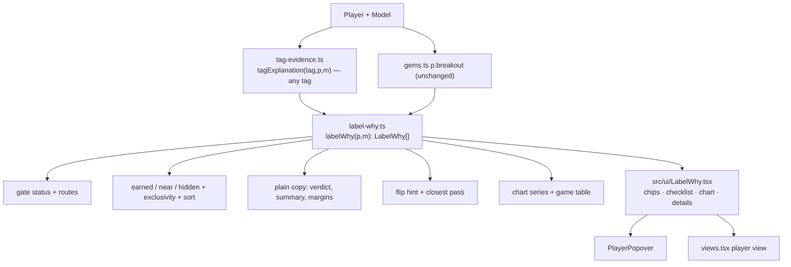

# Label "Why" Panel Redesign — Implementation Guide

> **For agentic workers:** Implement task by task, in order. Steps use checkbox (`- [ ]`) syntax. Every task ends with a green `npm run check`. Do not skip the consistency tests in Task 3: they are what keep the new panel honest.

**Goal:** Replace today's long "Why <label>?" evidence cards with a visual, plain-English, concise panel that (1) shows which checks a player met or missed and by how much, (2) also explains **near misses** (labels the player is 1–2 checks away from), (3) tells the user **what would flip** a near miss, and (4) charts the underlying story (workload or scoring by week).

**Version:** moderate change → bump to **0.9.0** (`npm version minor --no-git-tag-version`). Per AGENTS.md: major.moderate.minor ↔ npm major.minor.patch.

**Design reference:** the "Why Panel Redesign" canvas (owner's claude.ai artifact `3xmDUy9y19egkbk1D8RA5a`). Boards **"Popover · label earned"** and **"Popover · near miss"** are the target. Boards A/B/C are the explorations they were merged from. You may not be able to open the canvas: this guide restates every visual decision, so it is self-sufficient.

**Tech stack:** TypeScript, React 19, Vite, Vitest, Playwright, lucide-react icons. No new dependencies.

---

## 0. Ground rules (from AGENTS.md — non-negotiable)

- Read `docs/architecture.md` and `docs/implementation-plan.md` first.
- **All calculation lives in `src/domain`.** The new UI only renders what the domain returns: statuses, margins, positions, sentences, chart series, flip hints. The UI must never recompute a threshold, a margin or a pass/fail.
- **Null is not zero.** A missing value is "Unavailable" and is never charted as 0, never counted as a failed check, and never makes a near miss.
- Keep source timestamps (`m.dataset.sourceUTC`) visible.
- Never change label classification, valuation, forecasts or trade value. This is a presentation feature plus read-only diagnostics.
- Synthetic fixtures only in tests; no real league data.
- Before finishing: `npm run check`, `npm run build`, and the browser specs listed in Task 9.

---

## 1. Current state (what exists today)

| File | Role today |
| --- | --- |
| `src/domain/tag-evidence.ts` | `activeTagExplanations(p, m)` builds a `TagExplanation` (meaning, rows, interpretation, limitations, window) **only for labels the player currently has**. Rows carry `EvidenceComparison[]`. Also `gameEvidence(...)` builds game lists as joined strings. |
| `src/domain/gems.ts` | `assessGem` → `p.breakout: GemAssessment` with `checks` (Gem gates), `preGemChecks`, `reducedWorkload`, each `GemCheck` has `status: PASS/FAIL/UNKNOWN/UNRESOLVED` + `comparisons`. Computed for every RB/WR/TE whether or not the label is earned. |
| `src/domain/evidence-comparison.ts` | `evidenceComparison(required, actual, unit, operator, note)` and `evidenceCondition(...)` → `EvidenceComparison` with `numeric {threshold, value, unit, operator}` or `condition`. |
| `src/domain/evidence-meter.ts` | `evidenceMeter(comparison, tag, check, remainingWeeks)` → display bounds, `playerPosition`, `thresholdPosition` (%), `qualifies`, `favorableIncreases`. **Reuse it for the mini bars.** |
| `src/domain/valuation.ts` (~L500–680) | Classifiers: regression (`p.regression`: BUY LOW / SELL HIGH), legacy `p.gem` (Projection-gap watch, TD caution), `o.signals` (Role-growth watch, Scoring breakout watch, Reduced workload), and primary `p.gem = p.breakout.classification` (Gem / Pre-gem / Watch). Not computed in workbook mode. |
| `src/domain/historical-label-reference.ts` | `historicalLabelContext(tag, check, p, m)` and `labelResearchNote(tag)` — descriptive context. |
| `src/ui/GemEvidence.tsx` | Renders one `<details>` "Why Gem?" plus one per active explanation, using `EvidenceChecks` → `EvidenceMeter`. |
| `src/ui/EvidenceMeter.tsx` | Meter/status components. Only used by `GemEvidence.tsx`. |
| `src/ui/PlayerPopover.tsx:399`, `src/features/views.tsx:751` | The two mount points (player popover, full player view). |
| `tests/tag-evidence.test.ts`, `tests/gems.test.ts`, `tests/pre-gem.test.ts`, `tests/browser/gem-screening.spec.ts` | Existing coverage that must keep passing (browser spec needs selector updates, Task 9). |

Labels in scope (all of them): **Gem, Pre-gem, Watch, Role-growth watch, Scoring breakout watch, Projection-gap watch, Reduced workload, BUY LOW, SELL HIGH, TD caution.**

---

## 2. Decisions already made (do not re-ask)

| # | Decision |
| --- | --- |
| D1 | Near misses are computed for **every** label, including warning labels (Reduced workload, BUY LOW, SELL HIGH, TD caution). |
| D2 | A near miss = **1 or 2 failed gates**, **zero** UNKNOWN/UNRESOLVED gates, and every trust **condition** gate passing (history complete, model data usable, workload counts usable, availability resolved). Trust **sample-size** gates (games played, earlier games, cumulative opportunities) are ordinary gates: when one fails it counts toward the 1–2 misses, because time fixes it and the player's numbers are real. Missing data is never a near miss. |
| D3 | Near misses appear **only in the Why panel** (player popover and full player view). Tables, badges, the Gem screener and filters are unchanged. |
| D4 | Today's long-form content (meaning, interpretation, limitations, research note, historical reference, provisional-floor note, window text, source timestamp) is **kept, collapsed** under "Details and caveats" at the bottom of each panel. The stale-snapshot warning stays **visible** under the verdict. |
| D5 | The per-game lists move behind a **"Show the N games"** button, rendered as a small table (not joined strings). |
| D6 | Primary popover layout: two columns (checks left, chart right) at the popover's 1040px width; stacks to one column in narrow containers / the phone sheet. Same component in the full player view. |
| D7 | Flip hints ("What would flip it") ship for labels driven by a recent/season average: Role-growth, Scoring breakout, Projection-gap, Watch. **Not** for Gem/Pre-gem (overlapping windows with per-game floors) or warning labels in v1 — omit the card there. |
| D8 | Labels never change. If the classifier says earned, the panel says earned; the gates must agree (Task 3 tests enforce it). |

---

## 3. Architecture



New files:
- `src/domain/label-why.ts` — all new logic and types.
- `src/ui/LabelWhy.tsx` — the panel (+ small subcomponents in the same file or `src/ui/label-why/`).
- `tests/label-why.test.ts`, `tests/label-why-consistency.test.ts`, `tests/browser/label-why.spec.ts`.

Changed files: `src/domain/tag-evidence.ts` (refactor + gate metadata), `src/ui/PlayerPopover.tsx`, `src/features/views.tsx`, `src/ui/styles.css`, `tests/browser/gem-screening.spec.ts`, `README.md`, `package.json`/`package-lock.json`.
Deleted (Task 8, only after nothing imports them): `src/ui/GemEvidence.tsx`, `src/ui/EvidenceMeter.tsx`.

---

## 4. Domain specification (`src/domain/label-why.ts`)

### 4.1 Types

```ts
export type LabelTone = "positive" | "warning";        // warning = Reduced workload, BUY LOW, SELL HIGH, TD caution
export type LabelState = "earned" | "near" | "hidden";
export type GateStatus = "PASS" | "FAIL" | "UNKNOWN";  // UNRESOLVED and condition UNKNOWN map to UNKNOWN; WAIVED counts as PASS
export type GateGroup = "signal" | "trust";
export type ThresholdSource = "setting" | "policy" | "espn" | "model"; // setting = editable in Model & audit; policy = fixed code constant (labelPolicy/preGemPolicy/defaultGemRules); espn = imported projection; model = peer statistic
export type MarginTone = "spare" | "close" | "at-line" | "short" | "none";

export interface WhyGate {
  id: string;                    // stable, e.g. "role-growth.recent-rate"
  label: string;                 // plain English, see §4.3
  sublabel?: string;             // e.g. "5.20 → 7.67 targets"
  group: GateGroup;
  status: GateStatus;
  kind: "numeric" | "condition";
  value: string;                 // compact display, e.g. "7.67 / game", "+47%", "Complete"
  threshold?: string;            // compact, e.g. "≥ 5.00"
  thresholdSource?: ThresholdSource;
  margin: { text: string; tone: MarginTone };   // §4.6
  meter?: { player: number; threshold: number; clippedHigh: boolean; clippedLow: boolean; favorableIncreases: boolean }; // from evidenceMeter, % positions
  shortPhrase?: string;          // used in summaries, e.g. "recent targets are 0.70 short"
  historical?: { text: string; note: string; unavailable: boolean }; // from historicalLabelContext
  detail?: EvidenceComparison[]; // sub-comparisons kept for Details (e.g. Gem per-game floors)
}

export interface LabelWhy {
  tag: string;                   // exact classifier label string
  tone: LabelTone;
  state: Exclude<LabelState, "hidden">;
  failed: number;                // count of FAIL gates
  chip: string;                  // "Role-growth watch" | "Scoring breakout · 1 short" | "SELL HIGH · almost"
  verdict: string;               // §4.7
  summary: string;               // §4.7
  groups: { id: GateGroup; title: string; met: number; total: number; gates: WhyGate[] }[]; // signal first
  flip?: { headline: string; detail: string; caveat: string };     // §4.8 (near, positive, D7 labels)
  closest?: { headline: string; detail: string };                  // §4.9 (earned only)
  chart?: WhyChart;              // §4.10
  games: WhyGameRow[];           // §4.11
  canAdjust: boolean;            // any gate.thresholdSource === "setting"
  stale: boolean;                // same rule as today's GemEvidence
  details: {                     // D4 — verbatim from existing domain text
    meaning: string; interpretation?: string; limitations?: string; researchNote: string;
    window?: string; sourceUTC: string | null; notes: string[]; // provisional floor, Gem warnings, RB carries/targets note, Gem rule paragraphs
  };
}

export function labelWhy(p: Player, m: Model): LabelWhy[]; // sorted, hidden removed
```

### 4.2 Refactor `tag-evidence.ts` (no behaviour change)

1. Extract the body of each `if (active.has(TAG)) explanations.push({...})` block into a builder `buildExplanation(tag, p, m): TagExplanation | null` (returns `null` when the tag does not apply to the position or required inputs such as `p.breakout` are absent).
2. Export `tagExplanation(tag, p, m)` = builder **without** the active check, with the game-evidence rows appended exactly as today.
3. `activeTagExplanations(p, m)` becomes: filter tags by `active`, call the builder, append game rows. **Its output must be byte-for-byte identical to before** — add a test that snapshots the current output for every fixture player *before* the refactor and compares after.
4. Add optional gate metadata to `TagEvidenceRow` (ignored by the old UI):

```ts
gate?: {
  id: string;
  label: string;               // plain label (§4.3)
  group: GateGroup;
  routes?: number[][];         // indexes into comparisons; gate passes if ANY route has ALL its comparisons passing. Default: [[all indexes]]
  perComparison?: boolean;     // true = each comparison is its own gate (Reduced workload, Role-growth sample counts)
  thresholdSource: ThresholdSource | ThresholdSource[]; // per comparison when an array
};
```

Rows without `gate` (Earlier workload, ESPN projection, peer mean, SD, game evidence, "Gem requirements not met", "Pre-gem requirements not met") are **context**, not gates. They feed sublabels, summaries, chart lines or Details.

Gem and Pre-gem gates come from `p.breakout.checks` / `p.breakout.preGemChecks`: one gate per `GemCheck`, status from `GemCheck.status`, display from `comparisons[0]`, remaining comparisons (per-game floors, completeness conditions) go to `detail`.

### 4.3 Gate table (plain labels, groups, sources)

Plain labels are short (≤ 28 chars), no jargon, no "AND/OR". The unit noun is position-aware: QB "carries", RB "carries + targets" → say **"touches"**, WR/TE "targets".

| Label | Gate id → plain label | Group | Threshold source |
| --- | --- | --- | --- |
| Role-growth | history+model → "Full game history", "Model data usable" (two condition gates) | trust | — |
| | recent games ≥ 3 → "Recent games played" | trust | policy |
| | earlier games ≥ `GemMinPriorGames` → "Earlier games played" | trust | setting |
| | recent rate ≥ minimum → "Recent {unit} / game" | signal | setting (QB: policy) |
| | delta ≥ `roleGrowth` → "Jump vs. earlier" (sublabel "prior → recent {unit}") | signal | policy |
| | delta ≥ 20% of earlier → "Jump as a share" (display as % growth: delta/prior, threshold 20%) | signal | policy |
| Scoring breakout | history+model → trust conditions | trust | — |
| | games ≥ 3 + `GemMinPriorGames` → "Games played" | trust | setting |
| | recent PPG ≥ ESPN season projection → "Recent PPG vs. ESPN projection" | signal | **espn** |
| | trendDelta ≥ `GemMinGap` → "Scoring jump vs. earlier" | signal | setting |
| Projection-gap | history+model; games ≥ `GemMinGames` → "Games played" | trust | setting |
| | gap ≥ `GemMinGap` → "Season PPG above ESPN" | signal | setting |
| | gapPct ≥ `GemMinGapPct` (WAIVED when projection ≤ 0) → "…as a share" | signal | setting |
| | recent ≥ projected → "Recent PPG vs. ESPN projection" | signal | espn |
| Watch | Verified history row → "Games played" + "Full game history" + "Workload counts usable" | trust | policy |
| | positive change > 0 → "Workload is rising" | signal | policy |
| | Level OR growth → **one gate** "Volume or growth", routes `[[0],[1,2]]` (level) OR (abs AND pct; WAIVED pct passes) | signal | policy |
| | Short-sample branch (< 5 games): only "Recent {unit} / game" level gate | signal | policy |
| Gem | each `p.breakout.checks` entry: "Games played", "Recent 3 · PPG", "Recent 3 · scoring floor games", "Recent 3 · {unit}/game", "Recent 3 · workload floor games", same for "Previous 3", "Available to play" | history/availability → trust; rest → signal | policy |
| Pre-gem | each `preGemChecks` entry: "Games played", "Scoring jump", "Workload holding up", recent-window checks, "Available to play" | as Gem | policy |
| Reduced workload | `perComparison`: "Average drop", "Drop as a share", "Games clearly lower", (and the 4th comparison in `gems.ts` — read it and label it plainly) | signal (games-count gate → trust) | policy |
| BUY LOW | "Opportunities (sample)", "High-volume role" (≥ positional 80th pct), "TD rate below norm" | sample → trust; others signal | setting / model / model |
| SELL HIGH | "Opportunities (sample)", "Not a high-volume role" (< cutoff), "TD rate above norm" | same | same |
| TD caution | history+model, "Games played", + SELL HIGH gates | as above | setting / model |

### 4.4 Gate status algorithm

```
comparisonPass(c):
  c.condition === "PASS" | "WAIVED" → PASS ; "FAIL" → FAIL ; "UNKNOWN" → UNKNOWN
  numeric with null value or threshold → UNKNOWN
  else evidenceMeter(c, tag, check).qualifies ? PASS : FAIL   // reuse; it handles ≥ > ≤ < and strict equality
gateStatus(row):
  if GemCheck-backed → map status (UNRESOLVED→UNKNOWN)
  routes = row.gate.routes ?? [[...all]]
  if any route has every comparison PASS → PASS
  else if any comparison in any route is UNKNOWN and no route is fully decidable as FAIL → UNKNOWN
  else FAIL
```

Display for a multi-route gate (Watch "Volume or growth"): show the route closest to passing (smallest normalized shortfall, §4.6) as the gate's value/threshold; put the other route in `detail`.

### 4.5 Earned / near / hidden, exclusivity, dedupe, sorting

**Earned** comes only from the classifier, never from gates:

| Label | Earned when |
| --- | --- |
| Gem / Pre-gem / Watch | `p.breakout?.classification === tag` |
| Role-growth, Scoring breakout, Reduced workload, Projection-gap, TD caution | `p.opportunity.signals.includes(tag)` |
| BUY LOW / SELL HIGH | `p.regression === tag` |

**Near** (not earned) requires all of: label applies to the position (Gem/Pre-gem/Watch/Reduced workload/BUY LOW/SELL HIGH/TD caution: RB/WR/TE; Role-growth & Scoring breakout: QB/RB/WR/TE; Projection-gap: any with a projection); `failed ∈ {1,2}`; no UNKNOWN gate; all trust **condition** gates PASS; not blocked by exclusivity; not a duplicate. Failed trust **numeric** (sample-size) gates count toward `failed` like any other gate (D2): a player one game short of "Games played" and otherwise passing is a valid "· 1 short" near miss.

**Exclusivity:**
- Primary ladder Gem > Pre-gem > Watch: show a primary near miss only if it ranks **above** the earned primary (a Watch player may see "Gem · 1 short"; a Gem player sees no Pre-gem/Watch near miss).
- BUY LOW ⟂ SELL HIGH: never show the opposite of an earned regression label.
- TD caution echoes SELL HIGH: if TD caution and SELL HIGH would show the same failing gate ids, show only SELL HIGH.
- Generic dedupe: if two near misses have identical failing gate id sets, keep the higher-priority one.
- If every gate passes but the label is not earned (e.g., legacy Projection-gap precedence), state is `hidden` (do not invent a reason).

**Workbook mode** (`m.analysisVersion === "v5.2-workbook"`): no near misses; earned labels only (classifiers are not run there).

**Sort:** earned positive (Gem, Pre-gem, Watch, Role-growth, Scoring breakout, Projection-gap) → earned warning (SELL HIGH, TD caution, BUY LOW, Reduced workload) → near misses by `failed` asc, then smallest total normalized shortfall. Cap the chip row at 6; if more, the 7th+ are dropped (log nothing, it is presentation only).

**Default selection** (UI): first item in the sorted list.

### 4.6 Margins and tones

Normalized margin `r = delta / |threshold|` where `delta` is signed in the passing direction (same as `evidenceComparison`). Constants exported from `label-why.ts`:

```ts
export const WHY_CLOSE_FRACTION = 0.25; // pass within 25% of the threshold = "close"
```

| Case | tone | text |
| --- | --- | --- |
| FAIL | short | `"{|delta|} short"` (games: `"1 game short"`; %: `"4 pts short"` in percentage points) |
| PASS, delta = 0 (non-strict) | at-line | `"Right at the line"` |
| PASS, threshold ≠ 0 and r ≥ 1 | spare | `"{(value/threshold).toFixed(1)}× the bar"` (only for ≥/>; skip for games) |
| PASS, threshold ≠ 0 and r ≤ WHY_CLOSE_FRACTION | close | `"+{delta} · close call"` |
| PASS otherwise | spare | `"+{delta} to spare"` |
| Maximum operators (≤ / <) | — | use `"{delta} under the limit"` / `"{delta} over the limit"` |
| threshold = 0 | spare/short | no ratio, no "close" |
| condition gate PASS/FAIL | none | `"Yes"` / `"No"` |
| UNKNOWN | none | `"Unavailable"` |

Number formatting: 2 decimals for rates/PPG, 0 for games, whole % for shares (`+47%`). Unit stays in the value column (`7.67 / game`), not repeated in the threshold (`≥ 5.00`).

For **warning** labels the icon meaning stays literal (✓ = condition met) but colour is neutral/amber, see §5.3.

### 4.7 Verdict and summary copy

Verdicts:

| State × tone | Verdict | Chip |
| --- | --- | --- |
| earned positive | `"{tag}: all {n} checks met"` | `"{tag}"` |
| earned warning | `"{tag}: flagged, all {n} conditions met"` | `"{tag}"` |
| near positive | `"{tag}: {k} check{s} short"` | `"{short tag} · {k} short"` |
| near warning | `"{tag}: not flagged, {k} condition{s} away"` | `"{short tag} · almost"` |

`short tag` drops trailing " watch" ("Scoring breakout watch" → "Scoring breakout").

Summary = one "story" sentence from real values + (near only) the failing gates' `shortPhrase`s joined with "and". Any null input → fall back to the existing `meaning` text. Templates (values formatted per §4.6):

- Role-growth: `"{Unit} climbed from {prior} to {recent} a game over the last 3 games."` + earned: `" The jump is big enough, recent enough and backed by enough games."`
- Watch: `"{Unit} went from {previous} to {recent} a game."`
- Scoring breakout: `"Scoring went from {earlier} to {recent} PPG; ESPN projects {projected}."`
- Projection-gap: `"{actual} PPG this season vs. ESPN's {projected}; last 3 games: {recent}."`
- Gem: `"Last 3 games: {recentPPG} PPG on {recentWorkload} {unit} a game."`
- Pre-gem: `"Scoring is up {trend} PPG with workload holding at {recent} {unit} a game."`
- Reduced workload: `"{Unit} fell from {previous} to {recent} a game."`
- BUY LOW: `"{opps} opportunities but a {tdRate} TD rate, below the {pos} norm of {mean}."`
- SELL HIGH / TD caution: `"{tdRate} TD rate on {opps} opportunities, above the {pos} norm of {mean}."`

Near suffix: `" Not yet: {phrase1} and {phrase2}."` e.g. *"Not yet: recent targets are 0.70 short and the jump is 0.40 short."*

Group titles: signal → Role-growth/Watch "Is the workload really up?"; Reduced workload "Is the workload really down?"; Scoring breakout "Is the scoring really up?"; Projection-gap "Is scoring beating the projection?"; Gem/Pre-gem "Is the production real?"; regression "Is the TD rate out of line?". trust → "Is there enough to trust?". Header shows `"{met} of {total}"`.

### 4.8 Flip hint (near misses, positive, D7 labels only)

All hints are about the **current 3-game window** and phrased as a rough guide. Caveat string (always): *"Based on the current 3-game window. The next game changes the window, so treat this as a rough guide."*

| Label | Target recent average | Headline |
| --- | --- | --- |
| Role-growth | `T = max(minimum, prior + roleGrowth, prior + |prior|·roleGrowthPct)`; `u = T − recentRate` | `"About {u} more {unit} a game over the last 3 games (≈ {3u} in total)"` |
| Watch (≥5 games) | level `T1 = rule.mean`; growth `T2 = max(previous + rule.growth, previous·(1 + growthPct))` (if previous = 0: `previous + rule.growth`); `u = min(T1, T2) − recent` | same form |
| Watch (<5 games) | `T = rule.mean` | same form |
| Scoring breakout | `T = max(projected, earlier + GemMinGap)`; `u = T − recent` (earlier is unaffected because it excludes the last 3) | `"About {u} more points a game over the last 3 games (≈ {3u} in total)"`; if the *only* failing gate is the ESPN one, add detail `"It also flips if ESPN lowers the season projection to {recent} or less."` |
| Projection-gap | season: `S = max(projected + GemMinGap, projected·(1 + GemMinGapPct))` (pct part only when projected > 0), `us = S − actual`, total `us·games`; recent: `ur = projected − recent` | combine the failing parts: `"About {us} more PPG on the season (≈ {total} points) and {ur} more a game over the last 3"` |

Rules:
- Only produce a hint when every failing gate is a lever in the table above, or a sample-size gate.
- **Sample-size misses get a hint for every label**, including Gem/Pre-gem and warning labels (this overrides D7, because it is a count, not an average formula):
  - Games-count gate: `"Needs {k} more played game{s}"` with `k = threshold − value`. For the Role-growth "Earlier games played" gate, recent games roll into the earlier window, so `k` is the same.
  - Cumulative opportunities gate: `"Needs about {k} more opportunities"`.
  - If a sample gate fails **together with** an average-based gate, the headline joins both, e.g. `"Needs 1 more played game, and about 0.7 more targets a game over the last 3"`. When the other failing gate has no lever (Gem/Pre-gem/warning), show only the sample sentence plus `"…and the other check must also clear"`.
  - Detail line for sample misses: `"The numbers so far already meet the other checks."` (only when the sample gate is the only miss).
- `u ≤ 0` must not happen for a near miss; if it does (rounding), omit the hint.
- **Verification (test):** for each formula, construct a synthetic player, raise the relevant average by exactly `u` (+1e-9), recompute the gate predicates through the same domain code, and assert all gates pass; with `u − 0.01` assert at least one still fails.

### 4.9 Closest pass (earned only)

Among PASS numeric signal gates, pick the smallest `r` (§4.6). If its tone is `close` or `at-line`, emit:
- positive label: headline `"What could undo it"`, detail `"{gate label} clears its bar by only {delta}. A quiet next game could drop the label."` (at-line: `"is exactly at the minimum, so there's no cushion."`)
- warning label: headline `"Closest to clearing"`, detail `"{gate label} is only {delta} past the trigger."`
Otherwise omit.

### 4.10 Chart series

```ts
export interface WhyChart {
  metric: "workload" | "points";
  unitLabel: string;                       // "Targets per game", "Points per game", "Touches per game", "Carries per game"
  bars: { week: number; season: number; value: number | null; window: "recent" | "earlier" | "unused" }[];
  lines: { kind: "earlierAvg" | "recentAvg" | "threshold" | "espn" | "seasonAvg"; value: number; from: "earlier" | "recent" | "all"; label: string; source?: ThresholdSource }[];
  jump?: { from: number; to: number; label: string; tone: "spare" | "short" };   // bracket between averages
  gap?: { from: number; to: number; label: string };                            // shortfall bracket (near misses)
  ariaLabel: string;                       // full sentence describing the chart
}
```

| Label | metric | windows | lines |
| --- | --- | --- | --- |
| Role-growth | workload | recent = last 3; earlier = all earlier | earlierAvg (prior), recentAvg (recentRate), threshold (minimum, recent span) |
| Watch, Reduced workload | workload | recent = last 3; earlier = preceding 2–3; older games `unused` (light) | earlierAvg, recentAvg, threshold (level route mean) |
| Scoring breakout | points | recent = last 3; earlier = all earlier | earlierAvg (`p.earlier`), recentAvg (`p.recent`), espn (projected, all) |
| Projection-gap | points | all games `earlier` style, last 3 `recent` | seasonAvg (actual), recentAvg, espn |
| Gem / Pre-gem | points | recent = last 3; previous window = `earlier`; others `unused` | threshold (rule.points floor) |
| BUY LOW / SELL HIGH / TD caution | — | no chart (season-cumulative data) | — |

Bars come from `playedHistory(m.dataset)` exactly as `gameEvidence` reads them (same counting rule: explicit null count = 0 in a verified game; absent/invalid = null). A null bar renders as a gap with a "–" label, never a zero-height bar.

### 4.11 Game table

`WhyGameRow = { season, week, window, points: number|null, targets?: number|null, carries?: number|null, tds?: number|null }`, same windows as §4.10, built from the same history rows as `gameEvidence`. Regression labels: season rows with TDs (as today).

---

## 5. UI specification (`src/ui/LabelWhy.tsx`)

### 5.1 Structure

```
<section class="label-why" aria-label="Label explanations">
  LabelChips          — toggle buttons (aria-pressed), one per LabelWhy; hint text when any near miss: "Dashed labels are near misses, not earned yet."
  <div class="label-why-panel" id=…>      — for the selected label
    Verdict (icon + verdict)  · Summary sentence · [stale notice]
    <div class="label-why-grid">          — 2 cols ≥ 860px container width, else 1
      Left:  CheckGroup(signal) · FlipCard (near) · CheckGroup(trust)
      Right: WhyChart card · ClosestCard (earned) · historical reference line · action buttons
    </div>
    <details> Details and caveats </details>
  </div>
</section>
```

- Return `null` when `labelWhy(p, m)` is empty (same as today when no active labels).
- **CheckGroup:** header row (title + `"{met} of {total}"`). Rows: grid `22px | 1fr | 112px | 96px | 104px` → icon · label (+ sublabel) · value + threshold · mini bar · margin pill. For a near miss, FAIL rows first. Condition gates that PASS collapse into small "✓ …" pills under the group instead of full rows (e.g. "✓ Full history", "✓ Model data usable", "✓ 5 earlier games (needs 2)" — numeric trust gates with tone `spare` may also collapse). Any FAIL or UNKNOWN gate always gets a full row.
- **Mini bar** (`aria-hidden`, the row text carries the meaning): 4px grey track, light-green segment from threshold to the favourable end, 2px threshold tick coloured by `thresholdSource` (§5.3), 12px dot at `meter.player` (green PASS / orange FAIL). Clipped values pin to the end.
- **FlipCard:** tinted orange card, eyebrow "WHAT WOULD FLIP IT", headline + detail, caveat as small muted text.
- **ClosestCard:** tinted amber card ("WHAT COULD UNDO IT" / "CLOSEST TO CLEARING").
- **Actions:** `Show the {n} games` (toggles the game table inline, `aria-expanded`), and `Adjust thresholds` → `<a class="button" href="#/model">` only when `canAdjust`.
- **Details and caveats** (`<details>`, closed): meaning, interpretation, limitations, research note, window, notes[], `Source refreshed: {sourceUTC ?? "Unavailable"}. Displayed numbers are rounded; labels use unrounded calculations.`

### 5.2 Chart (`WhyChart`)

Inline SVG, `role="img"`, `aria-label={chart.ariaLabel}`, width 100% of its 384px card (viewBox-based, scales down). Bars: earlier = `#A8A3B4`, recent = `var(--pink)`, unused = `#E3E1E8`; recent window has a faint pink background band (`#FBEFF4`) with "Last 3" label, earlier side "Earlier {n}". Lines: earlierAvg solid `#4A4652`, recentAvg solid `#7A1243`, threshold dashed in its source colour, espn dashed `var(--blue)`, seasonAvg solid `#4A4652`. Jump bracket: 2px vertical green line between the averages at the window boundary with `+2.5` label; gap bracket orange with `−0.8`. Y axis: 0 and one mid gridline only. X labels: W{week} for first, last-earlier, first-recent, last. Legend row under the chart with the three line values in words ("Earlier 5.20", "Last 3 7.67", "Minimum 5.00" / "ESPN projection 10.2"). Hover/focus tooltip per bar is optional (nice-to-have, not required).

### 5.3 Tokens (add to `:root` in `styles.css`; reuse existing vars where noted)

| Token | Value | Use |
| --- | --- | --- |
| `--why-met` | `#1E7B4F` (text `#1A6B44`) | PASS icon/dot, spare text |
| `--why-met-bg` | `#E3F2EA` | PASS icon bg, spare pill, earned-positive chip |
| `--why-miss` | `#B4520A` (text `#9A4507`) | FAIL icon/dot, short text, near-positive chip border (dashed `#D9772E`) |
| `--why-miss-bg` | `#FCEBDD` | short pill, FlipCard (`#FDF3EA`) |
| `--why-close-bg` | `#FFF4D6` (text `#7A5300`) | close pill, ClosestCard (`#FFF8E6`) |
| `--why-neutral-bg` | `#EEECF1` (text `#4A4652`) | at-line pill, near-warning chip |
| threshold tick: setting | `var(--purple)` | editable setting (matches app legend: purple = editable) |
| threshold tick: espn | `var(--blue)` | ESPN projection (blue = ESPN) |
| threshold tick: policy / model | `#4A4652` | fixed rule / peer statistic |
| earned-warning chip | solid amber `#FFF4D6` bg, `#7A5300` text, 2px `#B07A00` border | warning labels |

Contrast: all text pairs above are ≥ 4.5:1 on their backgrounds; keep it that way if you adjust. Status is never colour-only: ✓/✗/– icon + text + pill wording.

Typography: inherit the popover font; panel base 13px, verdict 18px/700, summary 14px, row labels 13px/500, sublabels and pills 12px, chart labels 10–11px.

### 5.4 Responsive and accessibility

- Use a container query on `.label-why` (`container-type: inline-size`): ≥ 860px → two columns `minmax(0,1fr) 416px`, gap 24px; below → one column, chart after the signal group. Phone sheet (`.player-popover[data-layout="sheet"]`): chips wrap, rows switch to `22px | 1fr | auto` with value/threshold under the label and the mini bar full-width below. No horizontal scroll at 375px.
- Chips: real `<button type="button" aria-pressed>`; `aria-controls` the panel; min height 40px (44px on touch via existing sheet rules). Arrow keys not required.
- Icons from `lucide-react` (`Check`, `X`, `Minus`, `Info`), `aria-hidden`, with text equivalents present.
- The panel heading for screen readers: visually the eyebrow reads `WHY {TAG}?` (earned) / `WHY NOT {TAG}?` (near). Keep these exact strings so tests and users can find them.

### 5.5 Mount points

- `src/ui/PlayerPopover.tsx:399`: replace `<GemEvidence p={p} m={m} />` with `<LabelWhy p={p} m={m} />`.
- `src/features/views.tsx:751`: same replacement. Same component, layout adapts via the container query.
- Preserve the Watch-specific Gem warnings and the RB "carries / targets" note by routing them into `details.notes` (or, for Gem `assessment.warnings`, show them as visible notices under the summary like today — they are warnings, not caveats).

---

## 6. Tasks

### Task 1 — Lock current behaviour, refactor `tag-evidence.ts`
- [ ] Add `tests/tag-evidence-snapshot.test.ts`: for every player in every synthetic fixture (`tests/fixtures.ts`, `tests/surface-fixture.ts`, `tests/chain-fixture.ts` where they build a model), store `activeTagExplanations(p, m)` output (JSON) and assert equality after the refactor. Generate the expected data from the **unmodified** code first (inline snapshot or a committed JSON under `tests/__snapshots__`).
- [ ] Extract `buildExplanation(tag, p, m)` per §4.2; export `tagExplanation`; keep `activeTagExplanations` identical.
- [ ] Add optional `gate` metadata to `TagEvidenceRow` per §4.3 (no rendering change).
- [ ] `npm run check` green.

### Task 2 — Types, gate status, gate building
- [ ] Create `src/domain/label-why.ts` with the §4.1 types and constants.
- [ ] Implement `buildGates(tag, p, m): WhyGate[]` from `tagExplanation` rows (gate metadata) and `p.breakout` checks (Gem/Pre-gem/Reduced workload), including `meter` from `evidenceMeter`, `historical` from `historicalLabelContext`, routes per §4.4.
- [ ] Unit tests: routes (Watch level passes while growth fails → PASS; both fail → FAIL; growth pct WAIVED → treated PASS), UNKNOWN propagation, strict operators at equality → FAIL.

### Task 3 — States, exclusivity, consistency
- [ ] Implement earned/near/hidden, exclusivity, dedupe, workbook mode, sort, cap per §4.5.
- [ ] `tests/label-why-consistency.test.ts`: for every fixture player and every label: (a) classifier-earned ⇔ `state === "earned"`; (b) earned ⇒ every gate PASS (UNKNOWN allowed only where the classifier itself tolerates it — if you find one, stop and document it rather than loosening the test); (c) near ⇒ 1–2 FAIL, 0 UNKNOWN, all trust condition gates PASS. Include cases where the only miss is a sample-size gate (counts as a near miss) and where a trust condition fails (history incomplete → hidden, never near). Add synthetic players that are exactly one gate short for each label (build them by tweaking fixture rows) so every label has at least one near-miss case.
- [ ] Unit tests for exclusivity: Watch player shows Gem near miss; Gem player shows no Pre-gem/Watch near miss; SELL HIGH player never shows BUY LOW; TD caution deduped behind SELL HIGH.

### Task 4 — Copy
- [ ] Margins/tones/number formatting (§4.6), verdicts/chips/summaries/group titles (§4.7).
- [ ] Unit tests with exact strings for: spare, close call, at-line, ×-the-bar, short (rate, games, percentage points), maximum operators, threshold 0, null fallback to `meaning`.

### Task 5 — Flip hints and closest pass
- [ ] Implement §4.8 and §4.9.
- [ ] Verification tests exactly as described in §4.8 (raise by `u` → passes; by `u − 0.01` → still fails) for Role-growth, Watch (both branches and previous = 0), Scoring breakout (incl. ESPN-only alternative text), Projection-gap (season only, recent only, both, projected ≤ 0).
- [ ] Gem/Pre-gem/warning near misses have no `flip`.

### Task 6 — Chart series and game table
- [ ] Implement §4.10 and §4.11 using `playedHistory` and the same counting rule as `gameEvidence`.
- [ ] Tests: window assignment per label, null bars stay null, averages equal the domain values already on the player (`o.priorRate`, `o.recentRate`, `p.earlier`, `p.recent`, `assessment.previous/recent`), regression labels have no chart.

### Task 7 — UI components and styles
- [ ] Build `LabelWhy.tsx` per §5 (chips, verdict, groups, rows, mini bar, flip/closest cards, chart, games toggle, details).
- [ ] Add tokens and classes to `styles.css` (keep selectors prefixed `label-why`); no inline formulas, only `left: ${meter.player}%`-style positioning from domain values.
- [ ] No business logic in the component: if you need a number that the domain does not return, add it to the domain.

### Task 8 — Wire in, remove old UI
- [ ] Replace both mount points (§5.5).
- [ ] Confirm nothing imports `GemEvidence`/`EvidenceMeter`/`EvidenceChecks`, then delete `src/ui/GemEvidence.tsx` and `src/ui/EvidenceMeter.tsx` and their now-unused CSS (`evidence-*` classes) — grep first; keep anything still referenced.
- [ ] `npm run check` and `npm run build` green.

### Task 9 — Browser tests, docs, version
- [ ] Update `tests/browser/gem-screening.spec.ts`: lines that click `getByText("Why X?")` (≈ L235–244, 437, 673, 694–706, 772, 788, 838–855, 1251, 1272) now click the chip button (`getByRole("button", { name: "X" })`) and assert the `WHY X?` eyebrow / verdict. Keep every evidence assertion; update text expectations that moved into "Details and caveats" by opening that `<details>` first.
- [ ] Add `tests/browser/label-why.spec.ts` (synthetic fixture): earned label selected by default; near-miss chip shows "· N short" and a flip card; warning near miss shows "· almost"; "Show the N games" reveals the table; "Details and caveats" is closed by default and contains the source timestamp; stale notice visible for an old snapshot; at 375×812 there is no horizontal scroll (`document.documentElement.scrollWidth <= innerWidth`) and rows stack; keyboard: Tab reaches chips and they toggle with Enter/Space.
- [ ] Run `npm run test:browser -- tests/browser/label-why.spec.ts tests/browser/gem-screening.spec.ts tests/browser/player-popover.spec.ts`.
- [ ] README: under the labels/Gem screener section, add 3–4 sentences: the Why panel shows met/missed checks with margins, near misses (1–2 checks short, never from missing data) appear only in the player popover/view, flip hints are rough guides based on the current 3-game window, labels themselves are unchanged.
- [ ] `npm version minor --no-git-tag-version` → 0.9.0.
- [ ] Final: `npm run check`, `npm run build`.

---

## 7. Acceptance checklist

- [ ] Every label a player has today still appears, as an earned chip, with all the same evidence reachable (rows, Details, games).
- [ ] No near miss is ever produced from missing/unknown data or for a label that is mutually exclusive with an earned one.
- [ ] For a near miss of Role-growth / Watch / Scoring breakout / Projection-gap, the flip amount, applied to the data, actually clears every failed gate (tests prove it).
- [ ] Thresholds are coloured by source: purple (editable setting), blue (ESPN), dark grey (fixed rule / peer statistic). "Adjust thresholds" only appears when a setting is involved.
- [ ] No formulas in `src/ui`; `tag-evidence` legacy output unchanged (snapshot test).
- [ ] Popover at 1040px shows two columns; the phone sheet stacks with no horizontal scroll.
- [ ] Version 0.9.0; README updated; `npm run check`, `npm run build`, browser specs green.

## 8. Out of scope (possible follow-ups)

- Near-miss badges in tables/Gem screener or a near-miss filter (explicitly declined, D3).
- Flip hints for Gem/Pre-gem and warning labels.
- "What would flip it" projections into future weeks (forecasting the next game's effect on the rolling window).
- Persisting the selected chip across popovers.
