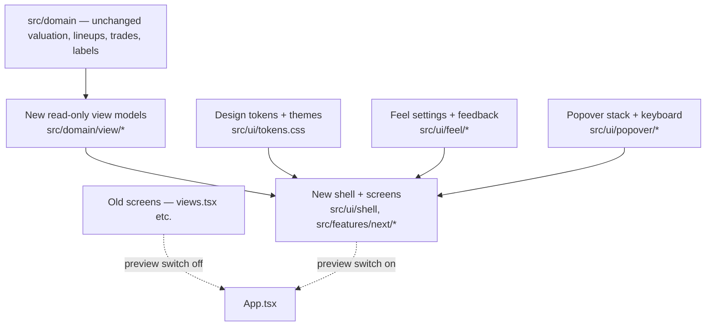

# Gameday Plus Redesign — Implementation Plan

> **For agentic workers:** Implement phase by phase, task by task, in order. Steps use checkbox (`- [ ]`) syntax. Every task ends with a green `npm run check`. Every phase ends with `npm run build` and the browser specs named in that phase. Do not start a phase until the previous one is green.

**Goal:** Replace the current interface of Fantasy Football Lab with the agreed "Gameday Plus" design, without changing any valuation, label, lineup or trade result, and without losing any existing feature.

**Design brief (read first, it is the source of truth for what to build):** `docs/superpowers/specs/2026-11-10-gameday-plus-redesign-brief.md`

**Design reference:** the owner's canvas `https://claude.ai/artifact/UpP7GTcDSV69N87aW87EjG`. Board 6 is the desktop design, 6b the same at iPad width, 7 and 8 the phone screens. You may not be able to open it. The brief restates every decision; where the canvas, the brief and this plan disagree, the brief wins, and where the brief and the existing domain code disagree on a number or formula, **the domain code wins**.

**Version:** a full interface overhaul is a major change. Per AGENTS.md (major.moderate.minor ↔ npm major.minor.patch), the cutover release is **1.0.0** (`npm version major --no-git-tag-version`). Until cutover, land work as moderate bumps behind the preview switch (Task 0.3) so the current interface keeps working.

**Tech stack:** TypeScript, React 19, Vite, Vitest, Playwright, lucide-react, Zod, IndexedDB via `idb`, Supabase sync. **No new runtime dependencies.** Charts stay hand-built SVG, as `src/ui/PlayerStockChart.tsx` is today.

---

## 0. Ground rules (from AGENTS.md — non-negotiable)

- Read `AGENTS.md`, `docs/architecture.md`, `docs/implementation-plan.md` and the design brief before changing anything.
- **All calculation lives in `src/domain`.** Every number, status, sentence, chart series, tag ("New", "Shifted from WR") and summary line the new interface shows is returned by a domain function. The UI never recomputes a threshold, a spread, a grade step or a pass/fail.
- **Null is not zero.** Unavailable values render as a quiet "—" or "N/A" with the reason on hover and focus. Never chart a missing value as 0. Never show a missing grade as F.
- **Never display "no change".** When something is unaffected, show nothing for it. Hide a section that has nothing to report.
- Keep source timestamps visible in the shell.
- Keep surplus exchange, lineup impact, legality and uncertainty as four separate verdicts.
- Do not change label classification, valuation, forecasts, lineup selection or trade value. Phases 1–8 are presentation plus read-only domain outputs. Phase 9 adds new read-only analyses.
- Synthetic fixtures only in tests and screenshots (`tests/fixtures.ts`, `tests/browser/label-why-seed.ts`). No real league data, workbooks or credentials in Git.
- Supabase changes must stay isolated from Trainwise tables. Only Task 9.4 may need storage changes; prefer the existing string-valued `state.filters` store.
- Add a short helper comment above each block of new code, as the codebase does today.
- You share this folder with other sessions. Commit only files you changed. Never stash, reset or switch branches without the owner's say-so.

---

## 1. What exists today (map before you move anything)

| File | Role today | Where it goes |
| --- | --- | --- |
| `src/app/App.tsx` | Shell, nine-item sidebar (`nav`), hash routes, import, sync, global notices | New shell (Phase 1); routing table changes |
| `src/ui/styles.css` (≈4,000 lines) | All styling | Replaced gradually; new tokens file first |
| `src/ui/layout.tsx`, `components.tsx`, `FilterHelp.tsx`, `SearchSection.tsx`, `PlayerName.tsx` | Panels, tables, help, player name link | Kept and restyled, or replaced by new primitives |
| `src/ui/PlayerPopover.tsx` | 1040px player popover | Becomes the single player card (Phase 2) |
| `src/ui/PlayerStockChart.tsx` | Fast/slow moving-average chart with hover | Reused as is, restyled (Phase 2) |
| `src/ui/NextRefreshScenarios.tsx`, `src/domain/next-refresh.ts` | Next-refresh EPPG scenarios | Promoted to the top of the card's Story tab |
| `src/ui/LabelWhy.tsx`, `src/domain/label-why.ts` | Why panel | Mounted in the card's "Why the labels" tab, layout unchanged |
| `src/features/views.tsx` | `Overview`, `TeamView`, `PlayerList`, `PlayerDetail`, `GemView`, `Weekly`, `TradeView`, `ModelView`, `Account`, `Welcome` | Split across This week, Roster, Scouting, League, Trade room, Lab |
| `src/features/RosterSimulator.tsx`, `src/domain/roster-scenarios.ts` | Hypothetical rosters, save slots 1–10 | Roster screen (Phase 4); also the target of "Force this trade" |
| `src/features/StarterLineupEditor.tsx`, `src/domain/starter-lineups.ts` | Marked starters | Roster screen (Phase 4). **Not drawn on the canvas; must be kept.** |
| `src/features/GemTracking.tsx`, `src/domain/gem-tracking.ts`, `gem-screening.ts`, `gems.ts` | Gem screener, tracking | Scouting (Phase 3) |
| `src/features/TradeWorkspace.tsx`, `TradeSearch.tsx`, `TradeSearchControls.tsx`, `TradeDiscovery.tsx`, `TradeResultGroups.tsx`, `PositionalGradeImpactControls.tsx`, `DeficitProtectionControls.tsx`, `ScenarioLineupBoards.tsx`, `SurfaceAppeal.tsx`, `TradeStressTest.tsx`, `SavedTrades.tsx` | Manual analyzer and Find trades | Trade room (Phase 6) |
| `src/features/TradeChains.tsx`, `ChainLegControls.tsx`, `src/domain/trade-chains.ts`, `chain-discovery.ts`, `chain-position-impact.ts`, `chain-plausibility.ts` | Chain planner, presets, strictness | Trade room (Phase 6) |
| `src/features/Negotiations.tsx`, `src/domain/trade-journal.ts`, `manager-expectations.ts` | Trade journal, manager profiles | Trade room → Journal |
| `src/features/EvidenceSettings.tsx` | Evidence sources | Lab (Phase 7) |
| `src/workers/*.worker.ts` | Model, import, trade search, chain search | Unchanged in Phases 1–8 |
| `tests/browser/*.spec.ts` (17 specs) | Browser acceptance | Each must keep passing; selectors updated as screens move |

**Before Phase 1, produce the parity checklist (Task 0.2).** The design was agreed screen by screen; several existing functions were never drawn (marked starters editor, stress test, market reference, requirements and conditions, required changes and optional pickups, injury return scenarios, role forecast calibration, gem tracking, import preview, sync conflict panel). "Nothing is removed" is a requirement, so each needs a home.

---

## 2. Decisions already made (do not re-ask)

| # | Decision |
| --- | --- |
| D1 | Navigation: one bar with This week · Roster · Scouting · League · Trade room · Lab. |
| D2 | Light and dark themes with a System option. No black fills in light mode, no white fills in dark mode. Selected state and primary buttons are yellow with dark text in both. |
| D3 | Expected PPG is the lead metric everywhere. Ranges read "EPPG ± spread" with floor and ceiling, using `next-refresh.ts` (blend of personal SD and positional reference). |
| D4 | One player card popover, everywhere, 1040px on desktop. No separate player page. Tabs: Story · Numbers · Why the labels · Calculation. Opens on the last tab used. |
| D5 | The moving-average chart and the Why panel behave as they do today. The gem screener filters by every badge as today, applied live. |
| D6 | Trade room keeps Manual analyzer, Find trades and Chain planner in full. Grade steps are small chips under each side, impacted positions only. |
| D7 | One search method: no strictness. Today's Balanced limits, shared and editable in one section used by Find trades and chains, with an "edited" marker. Automatic widening from the user's values; widened results are tagged and say which limit moved. Results ordered: passes every price test, then price warning, then widened. Price tests never hide a result. |
| D8 | Ten chain presets: the eight existing ones with "Surface-stat opportunities" renamed "Surface-stat trading", plus "Fix my weakest position" and "Buy low, then flip". Presets never change limits; saved presets do not store them. |
| D9 | Lineup gain shows "± spread": root of the summed squares of the spreads of players whose lineup spot changes. |
| D10 | Tablets use the desktop layout. Phone layout below 720px only, with a bottom bar and sheets, and **every control kept**. |
| D11 | Keyboard: Esc closes the top popover; focus moves in and returns to the opener; Tab is trapped in popovers; ↑ ↓ move through player lists; ← → step players in a card (same tab) and swap sides in versus. |
| D12 | Feel: Theme, Animation (System/Full/Reduced/Off, System follows `prefers-reduced-motion`), Sound (off by default), Haptics (off by default, "not supported" where the Vibration API is missing). Each independent, synced with the account. |
| D13 | Five added features ship after the core redesign (Phase 9): start or sit odds, league power ranges, add and drop pairs, since last import, counter-offer builder. The other fifteen proposals are out of scope. |

---

## 3. Verify in the code before building (report findings to the owner; do not guess)

1. **Index window versus "automatic".** `trade-search.ts` has `indexMode: "automatic" | "strict"`, and new searches use automatic (no window). The design shows an "Index window ±10" slider replacing "Use strict index range". Decide with the owner how the slider expresses "no window" (for example a top position labelled "Off"), and what the default is. Do not silently turn a window on for existing users.
2. **Balanced limits.** Read `strictnessLimits` and `applyChainStrictness` in `chain-discovery.ts` for the exact Balanced values and what else strictness sets (price policy). The canvas numbers are illustrative.
3. **Existing widening.** `chainSearchRounds` and the "Automatically broaden empty searches" controls already broaden. D7 should reuse this, changing its starting point and labelling, not add a second mechanism.
4. **Player pictures.** Find where today's player card pictures come from and reuse them in the lineup field and card header. The canvas uses initials as placeholders.
5. **Fonts offline.** The app is an offline-capable PWA (`vite.config.ts` writes `sw.js`). Web fonts must be self-hosted under `public/` and added to the cached shell, or the design must fall back cleanly. Check the font licence allows bundling before adding files.
6. **Marked starters.** The lineup basis switch (`trade-impact.ts`: `best-available` | `marked-starters`) must remain reachable in the Trade room and Roster.
7. **Grade scale.** Use the existing `positionGradeScale` and `gradeStepDelta` in `chain-position-impact.ts`. The canvas grade maths is a stand-in.

---

## 4. Architecture

- **Side by side until cutover.** Build new screens in a new folder (suggested `src/features/next/`) and mount them from `App.tsx` when the preview switch is on. Old screens stay untouched and remain the default until Phase 10.
- **View-model modules** (suggested `src/domain/view/`): pure functions that turn `Model`, `TradeResult` and friends into exactly what a screen renders. This is where new sentences, tags and summaries live, with unit tests.
- **Tokens:** one CSS file of custom properties (surface, ink, muted, line, the four provenance colours, selected yellow, positive/negative/warning chip pairs, the six grade colours) defined for light and again for dark. Components use tokens only; no literal colours in components. This rule alone prevents the dark-mode faults found during design.
- **State:** new preferences use the existing string-valued `state.filters` record (as `rosterScenariosKey`, `savedTradesKey` and `lineupBasisKey` do), so they sync with no schema change. Suggested keys: `uiPreview`, `feelTheme`, `feelAnimation`, `feelSound`, `feelHaptics`, `cardLastTab`, `searchLimits`, `foldedGroups`, `scoutingSavedSearches`.

---

## 5. Phases and tasks

### Phase 0 — Preparation

- [ ] **0.1 Baseline.** Confirm `npm run check`, `npm run build` and `npm run test:browser` are green before any change. Record counts in `docs/verification.md` style.
- [ ] **0.2 Parity checklist.** Create `docs/superpowers/specs/gameday-plus-parity-checklist.md`: one row per existing user-facing function (walk `views.tsx`, the trade files, `ModelView`, `Account`, and `docs/feature-parity.md`), with its new location. Anything without a location is raised with the owner before Phase 1 ends. This file is the acceptance list for Phase 10.
- [ ] **0.3 Preview switch.** Add a `uiPreview` setting and a toggle on the current Data & account screen. With it off, the app is byte-for-byte the current interface. Add a browser spec that toggles it and confirms the old interface still passes one existing workflow.

### Phase 1 — Foundations

- [ ] **1.1 Tokens and themes.** Token file with light and dark sets; `data-theme` on the root from the Theme setting, with System following `prefers-color-scheme`. Unit-test the resolver. Browser spec: switch themes and assert no element has a computed background of pure white in dark or the ink colour in light (sample the shell, a card, a chip, a selected control).
- [ ] **1.2 Feel settings and feedback.** `src/ui/feel/`: settings readers/writers on `state.filters`; a single `feedback(kind)` helper for tap, select, success, caution that plays a short Web Audio tone when Sound is on and vibrates when Haptics is on and supported; a root attribute for the effective animation level. All transitions are gated on that attribute. Tests: reduced-motion resolver; haptics reports unsupported without the API.
- [ ] **1.3 Shell and navigation.** New shell with the six sections, player search with live results, week and source freshness (amber after 24 hours, as today's stale rule), the hypothetical-roster chip, theme switch and Feel menu. Keep import, sync status, the import preview, the sync conflict panel, the update-ready notice and error notices working: they are behaviour in `App.tsx` today and must survive. Map old hash routes to new ones so existing links keep working.
- [ ] **1.4 Popover stack and keyboard.** `src/ui/popover/`: a stack that renders popovers above the page, closes only the top one on Esc, moves focus in on open, returns it to the opener on close (a stack of openers, so closing a card over a list returns to the list row), and traps Tab. A list-navigation helper for ↑ ↓ over rows marked as player rows, ignored inside inputs, selects and sliders. Browser spec covering each rule in D11.
- [ ] **1.5 Primitives.** Restyled card, pill, segmented control, chip, folding group (one-line summary when folded, remembers open state in `foldedGroups`), range slider with "edited" marker, floor-to-ceiling bar, skeleton. Each takes tokens only.

*Phase gate:* `npm run check`, `npm run build`, existing browser specs with preview off, new specs with preview on.

### Phase 2 — Player card

- [ ] **2.1 View model.** `playerCard(m, id)` returning header values (EPPG, floor, ceiling from `nextRefreshDefaults`, recent, surplus), the Numbers groups by provenance with an "unavailable (N)" list and reasons, Story sentences, radar axes normalised within position with gaps for missing inputs, and the Calculation steps. Unit tests include a player with missing role data and a K or D/ST.
- [ ] **2.2 The popover.** Rebuild `PlayerPopover` content with the four tabs. Story: next-refresh scenarios (reuse `NextRefreshScenarios`), sentences, radar, `PlayerStockChart` with today's hover values (points, fast MA, slow MA, touches) plus tap on touch devices. Why the labels: mount `LabelWhy` unchanged in layout. Remember the last tab (`cardLastTab`).
- [ ] **2.3 Open from everywhere.** Route every player name through one `openPlayer(id, list?)`. When a list is supplied, show previous / next and position ("2 of 31"); ← → step and keep the tab.
- [ ] **2.4 Retire the player route.** `#/player/:id` opens the card over This week instead of a page.
- [ ] Browser specs to update: `player-popover.spec.ts`, `player-stock-chart.spec.ts`, `player-ma-badge-click.spec.ts`, `label-why.spec.ts`.

### Phase 3 — Scouting

- [ ] **3.1 One explorer.** Replace Players, Gem screener and Weekly streamers with Scouting. Keep `gem-screening.ts` as the filter engine: `GemQuery`, `decodeGemFilters`, `encodeGemFilters`, `screenGems`, `risingGemDraft`, `gemQuerySummary`. Saved filters must still load.
- [ ] **3.2 Live facets with counts.** A domain function that, for a query, returns the match list and, for each option of each facet, the count if that option were toggled. No Apply button; validation errors from `validateGemDraft` show inline and block nothing else.
- [ ] **3.3 Filter panel.** Player pool, position, signals (every existing signal, Require all / Any of, Select all, Clear), golden cross, death cross, include injured, minimum trend, surplus and recent, and "Advanced filters" with the rest of today's set unchanged. Keep the "N more players match but are hidden by the selected signals" notice.
- [ ] **3.4 Results.** Cards and Table views, sortable, Expected PPG default. Card: team colours, EPPG, recent, floor-to-ceiling bar, badges, surplus. Saved searches: All, Gem screener, Rising targets, Buy low · sell high, Weekly streamers, plus user-saved (`scoutingSavedSearches`).
- [ ] **3.5 Gem tracking and comparison.** Give `GemTracking` a home in Scouting. Replace the three-name comparison with versus (two players, mirrored bars).
- [ ] Browser specs to update: `gem-screening.spec.ts`; add a facets spec.

### Phase 4 — Roster and League

- [ ] **4.1 Roster.** Depth chart by position (starters with yellow edge and solid outline, bench faint), each tile with role, EPPG and a weekly scoring strip. `RosterSimulator` in new chrome with every current capability and save slots. `StarterLineupEditor` kept here with its warnings.
- [ ] **4.2 League.** Grade grid for every team using existing grades and the six muted grade colours with letters. Clicking a grade opens a popover of that position group; each player opens the card above it. `TeamView`'s full roster table and position advice remain reachable from the team name.
- [ ] Browser specs to update: `roster-scenarios.spec.ts`, `starter-lineups.spec.ts`.

### Phase 5 — This week

- [ ] **5.1 View model.** `weekSummary(m, team)`: the outlook series versus league median with average and gap, the scoreboard rows, and up to three move cards (a trade idea from existing search output, a waiver target from screener output, a lineup note). Headline and deck sentences are built here from those results, never typed into the UI.
- [ ] **5.2 Screen and ticker.** Outlook card led by the big number, scoreboard, move cards, and the signals ticker (scrolls only at Full animation; a static scrollable row otherwise). `Welcome` and first-import states restyled.

### Phase 6 — Trade room

- [ ] **6.1 Lineup move list (domain).** From a `TradeResult`, per team and per phase (before, after): each starting slot with its player and a status (new, shifted from X, up from bench, leaves, to bench, unfilled), and a plain list of who is replaced and who shifts. Unit tests on synthetic trades, including unequal packages and marked starters.
- [ ] **6.2 Grade-step chips (domain).** Impacted positions only, each with before grade, after grade and signed steps, using `chainPositionImpact`. Nothing is returned for unimpacted positions.
- [ ] **6.3 Lineup gain spread (domain).** Combined spread per D9, with floor and ceiling, for the analyzer and for search rows. Include the "shares an NFL team" caveat flag.
- [ ] **6.4 Manual analyzer.** Two team-coloured sides with chips under each, tale of the tape, the lineup field (pictures, tags, before/after, your team/their team, week, lineup basis), the four verdict rows, and "Force this trade into a hypothetical roster" (creates a roster scenario). Keep, as disclosures under the relevant verdict: requirements and conditions, required changes and optional pickups, market reference, stress test, surface assessment.
- [ ] **6.5 Find trades.** Controls in folding groups with summaries; positional grade goals using today's step options, each with the plain-language line ("Your WR is D+ today. +2 steps means C or better."); results with both sides' chips, lineup gain ± spread, surplus, Analyze. Keep packages 1–5, protected players, targets, team needs, incoming filters, manager profiles and near-miss diagnostics.
- [ ] **6.6 Single search method.** Remove the strictness control and `applyChainStrictness` from the UI path; fix limits at Balanced; move limits into one shared, editable section (`searchLimits`) used by Find trades and chains; mark edits; widen from the user's values via the existing broadening rounds; tag widened results with which limit moved and by how much; order results by price-test status. Migration: saved searches and presets that carry a strictness or `indexMode` load into the single method with their other settings intact. Unit tests for the migration and ordering.
- [ ] **6.7 Chain planner.** Presets as cards with descriptions; rename `surface` to "Surface-stat trading" in `chainPresets` (label only, id unchanged); add `need` ("Fix my weakest position": +2 steps at the lowest-graded position, no drop beyond 2 elsewhere) and `flip` ("Buy low, then flip": trade 1 must receive a BUY LOW player, trade 2 must send a SELL HIGH player) to `applyChainPreset` with tests. Per-trade controls kept in full. Results show both steps, the connected result, spread, and, for Surface-stat trading, both sides' gains.
- [ ] **6.8 Saved trades and journal.** `SavedTrades` and `Negotiations` reachable from the Trade room header, restyled, behaviour unchanged.
- [ ] Browser specs to update: `trade-search.spec.ts`, `positional-grade-search.spec.ts`, `trade-chains.spec.ts`, `trade-stress.spec.ts`, `surface-appeal.spec.ts`, `negotiations.spec.ts`. Run the Excel parity checks in `docs/verification.md`: trade totals, deal grades and package tests must be unchanged.

### Phase 7 — Lab

- [ ] **7.1 Split `ModelView` and `Account`** into Settings, Evidence sources, Audits, Data and account, each a short page. Keep injury return scenarios, role forecast calibration, baseline audit, source audit, app version, import, sync, local data removal and cloud deletion.
- [ ] **7.2 Keyboard reference** and the Feel settings page.

### Phase 8 — Phones and tablets

- [ ] **8.1 Breakpoint.** Desktop layout down to 720px. Verify at 820px (iPad portrait) that the header stays on one row and the Trade room and player card are usable.
- [ ] **8.2 Touch.** 44px minimum targets on touch devices; every hover behaviour has a tap equivalent (chart values pin under the chart).
- [ ] **8.3 Phone shell.** Bottom bar (Week, Roster, Scout, League, Trades) and a header menu (Feel, Lab, journal, saved trades, import).
- [ ] **8.4 Phone screens** per brief section 11a: rows instead of tables, sheets for filters, pickers and the grade-goal editor, full-height player card with swipe, League grid with seven squares, stacked analyzer with the verdict cells pinned, folding settings groups, pinned search buttons.
- [ ] Browser specs at 390×844 and 820×1180 for one workflow per section; assert no horizontal page scroll.

### Phase 9 — Five added features (after the core is green)

- [ ] **9.1 Start or sit odds** in versus: probability from two EPPG values and spreads, with the plain reading. Unit tests at equal values (50%), clear edges and missing spreads (no figure shown).
- [ ] **9.2 League power ranges** on League: team totals with combined spread, ranked, with the chance the owner outscores each.
- [ ] **9.3 Add and drop pairs** on Roster: best legal drop per available player using existing drop rules, gain ± spread, "starts at" or depth only, and "Try in a simulation". Offer a switch that hides depth-only rows.
- [ ] **9.4 Since last import** on This week: store a compact per-player summary of the previous import (labels, EPPG; then grades, owner, injury) at import time and diff on the next. Update the "one current snapshot" wording in the app and `docs/architecture.md`. Decide with the owner whether the summary syncs. Empty state when there is no previous import.
- [ ] **9.5 Counter-offer builder** as a Trade room tab: one-swap and one-add alternatives from the current offer, both lineups' change, both-sides-gain first, "Use this", and logging as a journal counteroffer.

### Phase 10 — Cutover

- [ ] **10.1** Walk the parity checklist; every row verified in the new interface.
- [ ] **10.2** Make the new interface the default; remove the preview switch, the old screens and unused CSS. Delete only after nothing imports them.
- [ ] **10.3** `npm version major --no-git-tag-version` → 1.0.0. Update `README.md`, `docs/feature-parity.md`, `docs/architecture.md` (screen inventory, presentation), and add a dated entry to `docs/verification.md`.
- [ ] **10.4** Full verification: `npm run check`, `npm run build`, all browser specs against the production Pages-path preview, Excel parity checks, `node scripts/check-publication.mjs`.

---

## 6. Testing strategy

- **Domain additions:** Vitest unit tests beside the existing ones (`tests/*.test.ts`), synthetic fixtures only. Each view model has a test for the null path.
- **Consistency:** where the interface summarises a domain result (verdict words, grade chips, tags), add a test that the summary agrees with the underlying result, as `tests/label-why-consistency.test.ts` does for labels.
- **No behaviour change:** before touching trade code, snapshot the outputs of `evaluateTrade`, `searchTrades` and `searchTradeChains` on the existing fixtures; they must be identical after Phases 1–8, except where Task 6.6 deliberately changes search limits and ordering (document each difference).
- **Browser:** keep all 17 existing specs passing, updating selectors only. Add specs per phase as listed. Run with `RELEASE_VERIFY=true` against the Pages-path preview before each phase gate.
- **Accessibility:** real buttons and links, labels on inputs, focus visible, 4.5:1 text contrast in both themes, colour never the only cue (glyph with provenance, letter with grade).
- **Motion:** with reduced motion, no movement or chart draw-in; with Off, no transitions at all.

---

## 7. Risks

| Risk | Mitigation |
| --- | --- |
| A feature that was never drawn gets dropped | The parity checklist (0.2) is written before any screen is built and is the cutover gate. |
| UI recomputes domain numbers | View-model modules; review rule: no arithmetic on model values in `src/ui` or `src/features/next`. |
| Search results change unexpectedly when strictness is removed | Snapshot tests before 6.6; migration tests; list every intended difference. |
| Dark-mode regressions | Tokens only; the theme browser spec in 1.1 runs in every phase gate. |
| Two interfaces drift during the build | Old interface is frozen except for bug fixes; preview switch spec keeps it honest. |
| Fonts break offline use | Self-host and cache, or fall back; verify with the existing offline workflow in `app-update.spec.ts`. |
| The plan's file and function names are out of date | They were read on 2026-11-10 at commit `edbc75a`. Confirm each before relying on it. |

---

## 8. Definition of done

- Every row of the parity checklist is verified in the new interface.
- Valuation, labels, lineups, deal grades and package tests match the pre-redesign outputs on the fixtures and in the Excel parity checks.
- `npm run check` and `npm run build` are green; all browser specs pass against the production Pages-path preview at desktop, 820px and 390px, in light and dark.
- The app reports version 1.0.0, and README, architecture, feature-parity and verification docs describe the new interface.
- No real league data, workbook or credential is in Git or in the deployed assets.
