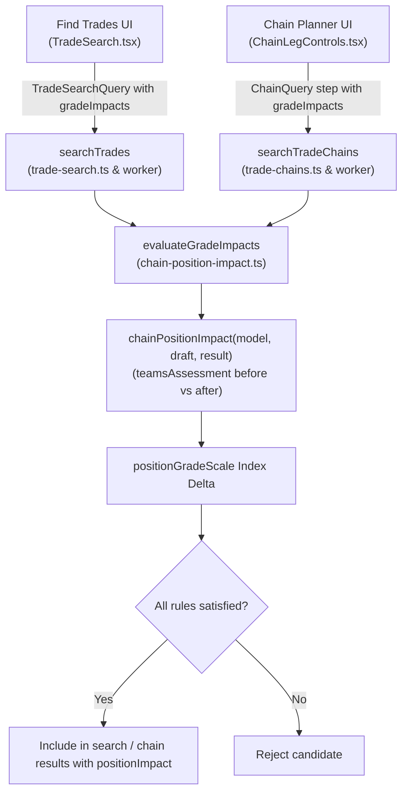

# Design Specification: Positional Grade Impact Search in Find Trades & Chain Planner

**Date:** 2026-11-06  
**Status:** In Review  
**Target Areas:** `src/domain/trade-search.ts`, `src/domain/trade-chains.ts`, `src/domain/chain-position-impact.ts`, `src/features/TradeSearch.tsx`, `src/features/ChainLegControls.tsx`, `src/features/TradeWorkspace.tsx`

---

## 1. Problem & Motivation

Users currently can search trades by raw EPPG gains, deficit targeting, or general recipient protections. However, fantasy managers frequently think in terms of **positional roster transformations**:
- *"I want to upgrade my WR room from C+ to B (at least +2 grade steps), while absorbing at most a 2-step drop at FLEX (e.g. B to C+)."*
- *"I want to target their elite WR (forcing a downgrade of at least 2 steps for them) while offering them an upgrade at FLEX of at least 2 steps."*
- *"In a two-step chain, Step 1 upgrades my RB room by +2 steps, and Step 2 flips surplus WR for a +2 TE upgrade."*

We need a flexible, multi-rule positional grade impact criteria engine supported in both **Find Trades** (single-trade search) and **Chain Planner** (multi-leg chains).

---

## 2. Core Concepts & Rule Semantics

### 2.1 Grade Step Scale
Grades are defined by the existing 13-tier `positionGradeScale` in `src/domain/trade-safeguards.ts`:
```
F (0) < D− (1) < D (2) < D+ (3) < C− (4) < C (5) < C+ (6) < B− (7) < B (8) < B+ (9) < A− (10) < A (11) < A+ (12)
```
The delta between post-trade grade ($G_{\text{after}}$) and pre-trade grade ($G_{\text{before}}$) is:
$$\Delta_{\text{steps}} = \text{index}(G_{\text{after}}) - \text{index}(G_{\text{before}})$$
- Upgrading from `C+` (6) to `B` (8) yields $\Delta = +2$.
- Dropping from `B` (8) to `C+` (6) yields $\Delta = -2$.

### 2.2 Rule Contract
```ts
export type GradeImpactSide = "own" | "other";

export interface PositionalGradeImpactRule {
  id: string; // Unique client identifier for list management
  side: GradeImpactSide; // "own" (Your team) | "other" (Their team)
  position: string; // "QB" | "RB" | "WR" | "TE" | "FLEX" | "K" | "D/ST"
  steps: number; // Signed integer: +1 to +5, -1 to -5, or 0
}
```

### 2.3 Evaluation Semantics
When evaluating a candidate trade against a rule:
1. **Your team (`side === "own"`)**:
   - $\text{steps} > 0$ (**Upgrade target**): Requires $\Delta_{\text{steps}} \ge \text{steps}$. (e.g. $+2$ requires at least a 2-step upgrade).
   - $\text{steps} < 0$ (**Drop budget / sacrifice limit**): Requires $\Delta_{\text{steps}} \ge \text{steps}$. (e.g. $-2$ requires that the position drops by *at most* 2 steps; $\Delta$ cannot be $-3$ or worse).
   - $\text{steps} = 0$ (**No drop**): Requires $\Delta_{\text{steps}} \ge 0$.

2. **Their team (`side === "other"`)**:
   - $\text{steps} > 0$ (**Incentive upgrade**): Requires $\Delta_{\text{steps}} \ge \text{steps}$. (e.g. they gain at least $+2$ steps at FLEX).
   - $\text{steps} < 0$ (**Depletion target**): Requires $\Delta_{\text{steps}} \le \text{steps}$. (e.g. targeting their star player, ensuring their position falls by at least 2 steps, so $\Delta \le -2$).
   - $\text{steps} = 0$ (**No drop for them**): Requires $\Delta_{\text{steps}} \ge 0$.

3. **Missing/Invalid Grades**:
   - If a team or position grade is unavailable (`"n.a."`) or not part of the league format, candidate fails the rule.
   - All specified rules must pass for the trade to be accepted (conjunction `AND`).

---

## 3. Architecture & Domain Changes



### 3.1 Domain Extensions
1. **`src/domain/chain-position-impact.ts`**:
   - Add `stepDelta: number | null` to `ChainPositionChange` for clean signed diff representation (`afterIndex - beforeIndex`).
   - Add `evaluateGradeImpacts(impact: ChainPositionImpact, rules: PositionalGradeImpactRule[]): { passes: boolean; failures: string[] }`.
2. **`src/domain/trade-search.ts`**:
   - Add `gradeImpacts?: PositionalGradeImpactRule[]` to `TradeSearchQuery`.
   - Add `positionImpact?: ChainPositionImpact` to `SearchRow`.
   - In `searchTrades` & `scoreTradeMatch`, evaluate `evaluateGradeImpacts` when `q.gradeImpacts` is populated. Candidates failing any rule are omitted (or recorded as near-miss reasons when near-miss scanning is active).
3. **`src/domain/trade-chains.ts`**:
   - Add `gradeImpacts?: PositionalGradeImpactRule[]` to `ChainStep`.
   - In `evaluateChainLeg` & chain filtering, evaluate `evaluateGradeImpacts` for step 1 and step 2.

---

## 4. UI/UX Design

### 4.1 Reusable Component: `<PositionalGradeImpactControls>`
Located in `src/features/PositionalGradeImpactControls.tsx`:
- Header: **"Positional Grade Goals"** with informative help tooltip.
- Dynamic rule rows:
  - **Team selector**: `[Your team | Their team]`
  - **Position selector**: `[QB | RB | WR | TE | FLEX | K | D/ST]` (pre-filtered to positions existing in league format)
  - **Impact selector**:
    - For *Your team*:
      - `+1 step (Upgrade ≥ 1)` to `+5 steps (Upgrade ≥ 5)`
      - `-1 step (Drop at most 1)` to `-5 steps (Drop at most 5)`
    - For *Their team*:
      - `+1 step (Upgrade ≥ 1)` to `+5 steps (Upgrade ≥ 5)`
      - `-1 step (Downgrade by ≥ 1)` to `-5 steps (Downgrade by ≥ 5)`
  - **Delete button**: `[✕]`
- **`+ Add Positional Goal` button**: Appends a new rule row (defaults to `Your team`, next available position, `+1`).

### 4.2 Integration Locations
1. **Find Trades (`src/features/TradeSearch.tsx`)**:
   - Placed in the Trade Search filter options.
   - Shows active rule count badge when collapsed.
2. **Chain Planner (`src/features/ChainLegControls.tsx`)**:
   - Rendered per leg (Step 1 and Step 2) so users can target distinct positional goals for each stage of the chain.
3. **Results Display (`TradeWorkspace.tsx`, `TradeSearch.tsx`, `TradeChains.tsx`)**:
   - Render the matching positional grade chips directly on search cards (`WR C+ → B (+2)`, `FLEX B → C+ (-2)`) so the user immediately sees how each trade fulfills their criteria.

---

## 5. Verification & Testing Strategy

1. **Unit Tests (`tests/positional-grade-impact.test.ts`)**:
   - Test grade delta calculations (`C+ -> B` = +2, `B -> C+` = -2).
   - Test upgrade rules on own team: pass on $\ge +2$, fail on $+1$ or $0$.
   - Test drop budget rules on own team: pass on $-1$ and $-2$, fail on $-3$.
   - Test depletion rules on other team: pass on $-2$ and $-3$, fail on $-1$ or $+1$.
   - Test multiple simultaneous rules across own and other teams.
   - Test missing/invalid grades handling.
2. **Integration Tests (`tests/trade-search.test.ts`, `tests/trade-chains.test.ts`)**:
   - Verify trade search filters results to only matching candidate trades.
   - Verify chain planner enforces step 1 and step 2 grade impact rules independently.
3. **Browser E2E Tests (`tests/browser/positional-grade-search.spec.ts`)**:
   - Add rules in Find Trades, run search, verify matching results and grade chips render.
   - Add rules in Chain Planner, run chain search, verify resulting chain trades satisfy rules.
4. **Full Verification Suite**:
   - `npm run check` (TypeScript + ESLint + Vitest)
   - `npm run build`
